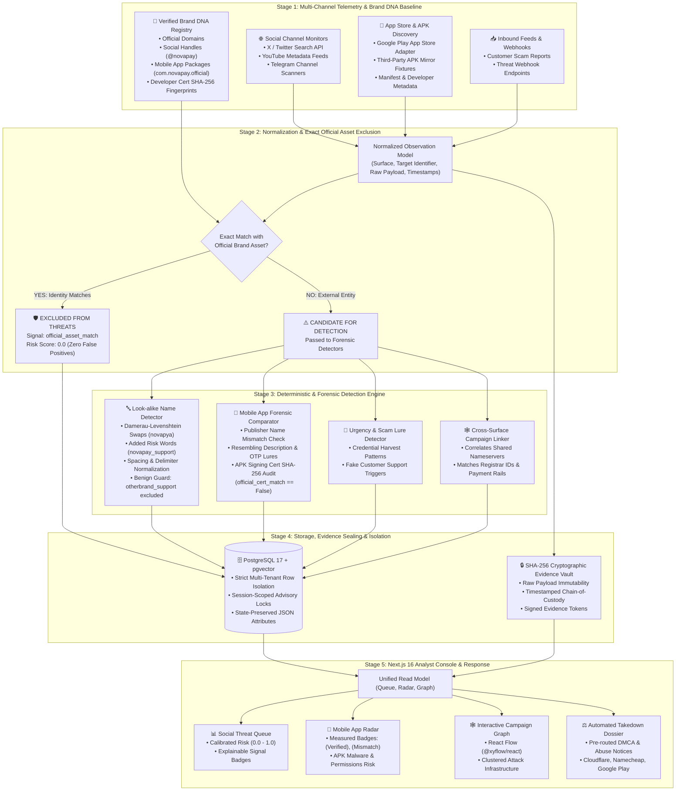

# ASTRA — End-to-End System Architecture

This document provides the complete architectural specification, Mermaid diagram source code, and slide explanation guide for the **Kampus.VC Digital Risk Protection (Social & App Monitoring)** challenge.

---

## 1. Complete Architecture Diagram (Mermaid Source)

You can copy and paste this directly into [Mermaid Live Editor](https://mermaid.live/) or GitHub markdown to generate a high-resolution PNG/SVG for your presentation slides:



---

## 2. Text / Slide-Friendly Architecture Layout (ASCII Box Diagram)

If you need a slide box diagram for a presentation tool like PowerPoint:

```text
┌────────────────────────────────────────────────────────────────────────┐
│ 1. DATA SOURCES & INGESTION                                            │
│ • Social Monitors (X, YouTube, Telegram) • Play Store & APK Adapters   │
│ • Verified Brand DNA (Official Handles, App Package IDs, Cert Hashes)   │
└───────────────────────────────────┬────────────────────────────────────┘
                                    │
                                    ▼
┌────────────────────────────────────────────────────────────────────────┐
│ 2. CANONICAL EXCLUSION GATEWAY (Zero False Positives)                  │
│ • Platform-aware identity comparison against verified Brand DNA        │
│ • Match  ──> Excluded (official_asset_match, Score: 0.0)               │
│ • Mismatch ──> Dispatched to Detection Engine                          │
└───────────────────────────────────┬────────────────────────────────────┘
                                    │
                                    ▼
┌────────────────────────────────────────────────────────────────────────┐
│ 3. FORENSIC DETECTION PIPELINE                                         │
│ • Look-alike Name Detector (Swaps, Suffixes, Delimiters, Benign Guard) │
│ • App Store Comparator (Publisher Mismatch, Resembling Bio, Cert Hash) │
│ • Cross-Channel Linker (Clusters Shared DNS, Hosts, and Payment Rails) │
└───────────────────────────────────┬────────────────────────────────────┘
                                    │
                                    ▼
┌────────────────────────────────────────────────────────────────────────┐
│ 4. EVIDENCE & STORAGE VAULT                                            │
│ • PostgreSQL 17 + pgvector (Multi-Tenant Isolation, Advisory Locks)    │
│ • SHA-256 Cryptographic Evidence Vault (Chain of Custody Proofs)       │
└───────────────────────────────────┬────────────────────────────────────┘
                                    │
                                    ▼
┌────────────────────────────────────────────────────────────────────────┐
│ 5. ANALYST CONSOLE & TAKEDOWN (Next.js 16)                             │
│ • Social Sightings Queue • Mobile App Radar • Interactive Graph View   │
│ • One-Click DMCA Abuse Dossier (Cloudflare, Namecheap, Google Play)    │
└────────────────────────────────────────────────────────────────────────┘
```

---

## 3. How to Present This Slide to Judges (Stage-by-Stage Script)

### Stage 1: Data Ingestion & Brand DNA Baseline
> **English:** *"Our architecture begins with dual ingestion: external telemetry from social media and app stores, paired with the organization's verified Brand DNA baseline—including official handles, package IDs, and signing certificate SHA-256 fingerprints."*  
> **Hindi:** *"Humara pipeline do inputs se start hota hai: pehla social media aur app stores se telemetry, aur doosra verified Brand DNA jisme company ke official handles, app package IDs, aur certificate fingerprints stored hote hain."*

### Stage 2: Identity Matching & The Exclusion Gate
> **English:** *"Before running any detection, our identity gateway performs platform-aware matching. If an account or app matches verified brand assets, it receives an auditable `official_asset_match` with a score of 0.0. This guarantees zero false positives on legitimate assets like `@novapay` or `com.novapay.official`."*  
> **Hindi:** *"Koi bhi detection run hone se pehle, humara exclusion gate check karta hai ki kya ye asset official brand ka hai. Agar match hota hai, toh use score 0.0 milta hai—jisse company ke apne accounts par zero false alarms ki guarantee milti hai."*

### Stage 3: Specialized Detection Pipeline
> **English:** *"Unverified candidates pass into specialized detectors: look-alike analysis catches character swaps, spacing mutations, and suffixes like `novapay_support`, while safely ignoring unrelated brands like `otherbrand_support`. The app comparator audits publisher names, resembling descriptions, and APK certificate signatures."*  
> **Hindi:** *"Bache hue unverified candidates forensic detectors ke paas jate hain: look-alike engine character swaps aur `novapay_support` jaise suffixes pakadta hai bina unrelated accounts ko flag kiye. Aur mobile comparator publisher mismatches aur fake certificate signatures pakadta hai."*

### Stage 4: Cryptographic Evidence Vault & Database
> **English:** *"Every raw observation is sealed inside our SHA-256 cryptographic evidence vault to preserve chain of custody for legal actions, while relational entities are secured within a tenant-isolated PostgreSQL 17 database."*  
> **Hindi:** *"Saare raw payloads ko hum SHA-256 cryptographic vault me seal karte hain taaki legal actions ke liye tamper-proof evidence rahe, aur data multi-tenant PostgreSQL database me safely store hota hai."*

### Stage 5: Analyst Console & Takedown Routing
> **English:** *"Finally, the Next.js 16 console presents honest, measured badges—`(Verified)`, `(Mismatch)`, `(Unverified)`—clusters threats on an interactive campaign graph, and generates one-click DMCA takedown dossiers pre-routed to registrar abuse desks."*  
> **Hindi:** *"Last stage me Next.js 16 console par analyst ko clear aur sachhe indicators dikhte hain, interactive graph par interconnected attacks cluster hote hain, aur one-click me Cloudflare ya Google Play ke liye formatted takedown dossier ban jati hai."*
