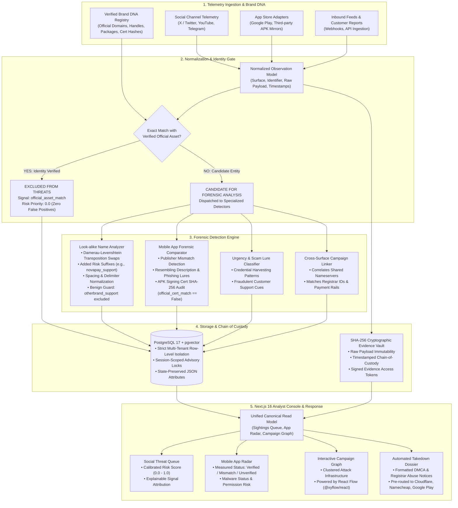

# ASTRA — System Architecture Specification

This document provides the architectural specification and Mermaid pipeline for the **ASTRA Digital Risk Protection Platform**.

---

## 1. High-Level Architecture (Mermaid)

---

## 2. Component Specification

### Stage 1: Telemetry Ingestion & Brand DNA Baseline
Ingests streaming external telemetry from supported platforms (social channels and app store sources) alongside customer-configured Brand DNA assets. Brand DNA acts as the ground-truth baseline against which all candidate observations are compared.

### Stage 2: Normalization & Identity Gate
Incoming observations are parsed into a normalized schema. Before running detection algorithms, the identity gateway executes platform-aware exact matching. Candidates matching verified brand properties receive an auditable `official_asset_match` signal with priority `0.0`, eliminating false alarms on brand-owned accounts and applications.

### Stage 3: Forensic Detection Engine
Unverified candidates undergo specialized detection:
* **Look-alike Analysis:** Evaluates character swaps, delimiter mutations, and risk suffixes while enforcing brand-presence requirements to prevent false positives on unrelated brands.
* **Mobile Forensics:** Compares developer/publisher metadata, analyzes description text for credential/OTP lures, and audits APK signing certificate SHA-256 fingerprints against official developer keys.
* **Campaign Linking:** Groups disparate observations into clustered threat campaigns based on shared infrastructure invariants (nameservers, registrar IDs, payment rails).

### Stage 4: Storage & Cryptographic Evidence Vault
Raw payloads are sealed with SHA-256 digests in an immutable evidence repository, ensuring forensic chain-of-custody for legal proceedings. Relational entities are persisted in PostgreSQL 17 with strict multi-tenant row isolation.

### Stage 5: Analyst Console & Takedown
The analyst console provides a single canonical read model across views, transparent status badges (`Verified`, `Mismatch`, `Unverified`), an interactive campaign graph, and automated takedown dossiers routed to upstream abuse desks.
