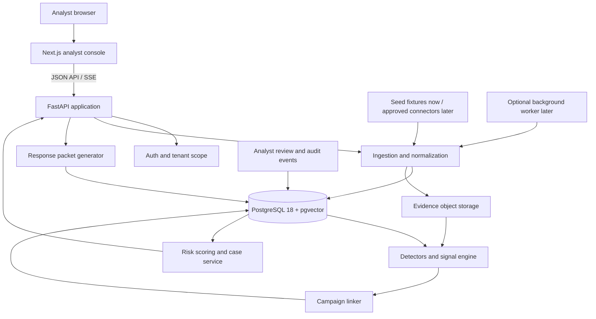

# Digital Risk Protection Platform: Research and Winning Approach

Oct 10, 2026 · @DigiGuru

Build a campaign-disruption system, not another alert feed: prove what is genuine first, link every fake across social, apps and payment IDs into one campaign, then cut it at the cheapest link.

## Where today's platforms leave gaps

The field is crowded (ZeroFox, Recorded Future, Netcraft, Doppel, Bolster, CybelAngel and others), but the sources point to six gaps a new build can target. Speed figures below are vendor-reported, so treat them as marketing until you measure your own.

| Gap | Evidence | What it means for the design |
| --- | --- | --- |
| Takedown is the slow step, and platforms control it | Instagram and Facebook take 1 to 5 days, TikTok 3 to 7, YouTube manual DMCA 7 to 14 ([MarqVision, Jul 2026](https://www.marqvision.com/blog/actual-brand-takedown-times)) | Detection speed alone does not cut exposure; add levers beyond the platform report |
| Speed claims are self-reported and inconsistent | Doppel claims under 10 hours median against a 58-day industry average ([Doppel](https://www.doppel.com/blog/brand-impersonation-takedown-agentic-ai)); MarqVision cites 5.3 hours for domains and Netcraft 33 minutes for phishing ([comparison](https://www.marqvision.com/blog/digital-risk-protection-solutions-comparison)) | Define one honest metric and benchmark it yourself |
| Apps are a blind spot | App stores are closed catalogs that standard crawlers cannot index, and Apple and Google police policy, not your brand name ([UpGuard](https://www.upguard.com/blog/the-blind-spot-in-brand-protection-why-app-stores-slip-past-standard-monitoring)) | Build a store-search watcher, not a web crawler |
| "Apps" now include things that are not in a store | Ads push fake Google Play pages and home-screen PWA installs dressed as trusted brands, reported across 400 brands ([Hoodline](https://hoodline.com/2026/07/facebook-fakers-hijack-400-big-name-brands-to-snag-cleveland-clicks-7044050/)) | Cover APKs, PWAs and ad landing pages as one "app" surface |
| Blocklists lag badly | In one study, mainstream blocklists flagged only 0 to 29.6% of 135 scam domains ([Anansi summary](https://www.emergentmind.com/papers/2602.24223)) | Cluster infrastructure yourself and confirm intent actively |
| Ownership is split and the metric is wrong | Marketing owns the channels but cannot run takedowns; the proposed fix is to treat impersonation like command-and-control and measure detection-to-takedown time and infrastructure recurrence rate ([SecurityAffairs](https://securityaffairs.com/?p=196359)) | Make those two numbers the product's headline metrics |
| India's scams cross platforms and rails | WhatsApp banned over 9,400 digital-arrest accounts in 12 weeks of 2026 ([Bar and Bench via Moneylife](https://moneylife.in/article/whatsapp-banned-9400-accounts-used-for-digital-arrest-scams-in-2026-ag-tells-supreme-court/80326.html)); I4C runs a searchable database keyed on UPI ID, phone, email and handle ([report](https://mobileidworld.com/india-launches-searchable-cyber-scammer-database-to-combat-digital-fraud/)) | Use UPI IDs, phone numbers and handles as linking keys between surfaces |

## The approach: six ideas, working name ASLI

ASLI (Authentic Source and Lookalike Intelligence; "asli" is Hindi for genuine) differs from existing tools in what it treats as the unit of work: a campaign, not an alert.

1. **Brand DNA vault: prove what is genuine first.** Each brand enrols a signed registry of its official handles, domains, app package names with signing-certificate hashes, logos, icons, screenshots, support phone numbers, UPI IDs and tone of voice. A detection is then "close to the DNA but not in the registry", which cuts false positives from fans and authorized resellers. The same registry generates likely lookalikes in advance (adding "official", "support", "pro" or a country name, which [fake-app publishers commonly do](https://www.redpoints.com/blog/how-to-spot-fake-apps)) so collectors can watch for them.
2. **Campaign graph: link fakes across surfaces.** A fake profile, a landing domain, an APK, a paid ad, a phone number and a UPI ID become nodes joined by shared pivots such as favicon, DOM, image hash, kit fingerprint and payment handle. Pivoting on one favicon, redirect pattern and DOM [led one team to over 100 related domains](https://www.bridewell.com/insights/blogs/detail/from-a-fake-it-ticket-to-scattered-spider-inside-a-com-affiliated-vishing-campaign), and clustering by the browser APIs a page executes [grouped phishing kits at 97% accuracy](https://arxiv.org/html/2509.13186v1) in one study.
3. **Exposure-weighted triage.** Rank by estimated victims at risk (reach, installs, ad spend, harm type), not by visual similarity. A credential-harvesting clone with 50,000 ad impressions outranks a dormant lookalike handle.
4. **Active confirmation, sandboxed and human-approved.** An agent can interact with a suspected scam channel using a synthetic persona to extract the payment handle or wallet, which both confirms intent and adds a pivot. Research on this approach [collected over 29,000 scam messages and engaged more than 1,900 scammers](https://www.emergentmind.com/papers/2602.24223). Keep it optional and limited to accounts impersonating the enrolled brand.
5. **Multi-lever response.** Report to the platform, but also to the registrar and host, blocklists, the payment rail (bank or payment provider) and the brand's own customers, then learn which lever removes each kind of fake fastest. Platforms alone are too slow (see the table above).
6. **Evidence-grade, explainable verdicts with an analyst loop.** Every verdict cites its evidence, captures are hashed and timestamped for takedown and police packets, and analyst accept or reject decisions feed back into the models, as [Doppel describes doing with its analyst data](https://openai.com/index/doppel).

## Architecture

&#91;embedded content: ASLI architecture · 5 layers, 1 feedback loop\]

Brand DNA decides what collectors watch for and what detectors compare against; the campaign graph is the single place that triage and response read from.

## Detection by surface

Each surface gets the cheapest method that the research shows works, and every one scores against the Brand DNA registry rather than a keyword list. Academic accuracy figures come from older datasets, so re-measure them on your own data.

| Surface | Signals and method | Limits |
| --- | --- | --- |
| Fake brand profiles | Homoglyph and edit-distance match on name and handle; image embedding and perceptual hash on avatar and banner; account age against claimed reach. For human-like fakes, network structure [beats profile-only features](https://arxiv.org/pdf/2010.07923), and [synchronized posting, repeated captions and reused media](https://www.arxiv.org/abs/2505.10867) expose coordinated clusters | Platform access and terms of service; private accounts; brand-new fakes have no graph yet |
| Executive impersonation and deepfakes | Name and face match against executives who consent to enrol a reference; fake support-line and ad checks; a verified-channel page and a call-back rule for money requests. Deepfake fraud drained [$1.1 billion from US corporate accounts in 2025, up from $360 million](https://fortune.com/2026/03/03/boards-arent-ready-for-the-ai-age-what-happens-when-your-ceo-gets-deepfaked/) | Synthetic-media detectors are an arms race, so lean on process (out-of-band verification) over classifier scores; enrolment needs consent |
| Scam accounts and messages | LLM intent classification that cites the message evidence; phone, UPI and wallet pivots into the campaign graph; optional active confirmation. Scam kits reuse templates and infrastructure, which [makes clustering productive](https://www.emergentmind.com/papers/2602.24223) | Messaging apps are closed, so much of the input must come from customer reports |
| Fake apps (store, APK, PWA) | Name-and-icon similarity (a [consumer-side method reached 91% on real repackaged apps](https://s2lab.kcl.ac.uk/downloads/fgcs2016.pdf)); shared-resource overlap, which survives added or removed code ([FSquaDRA](https://dl.ifip.org/IFIP-LNCS-8566/hal-01285035)); signing certificate against the registry; suspicious permission sets; PWA manifest and fake Google Play ad pages | Obfuscation weakens code-level similarity; strip third-party libraries before comparing, since [they can make up over 60% of an app's code](https://arxiv.org/pdf/1810.07780); check each store's terms before collecting |

## Scoring and response

Rank campaigns by how many customers they can still reach, then pull the fastest lever for that kind of fake. This is a proposed scoring rule to tune on labelled data, not a validated formula.

```latex
P = \text{reach} \times \text{confusability} \times \text{harm weight} \times \text{freshness}
```

Reach is followers, installs or ad impressions; confusability is the distance to the Brand DNA across name, icon and text; harm weight ranks credential theft and payment fraud above spam; freshness decays as the fake ages without removal.

| Lever | Best for | Speed evidence |
| --- | --- | --- |
| Platform report | Profiles, posts, paid ads | 1 to 5 days on Instagram and Facebook, 3 to 7 on TikTok; filing as a verified rights owner [shortens it](https://www.marqvision.com/blog/actual-brand-takedown-times) |
| Registrar, host and blocklist submission | Domains, phishing kits, app landing pages | Vendor-reported medians range from [33 minutes to 5.3 hours](https://www.marqvision.com/blog/digital-risk-protection-solutions-comparison) |
| Payment-rail report | UPI IDs, wallets, card acceptors | No timing source found; the aim is to cut the scammer's revenue, and some vendors cite [payment-provider partnerships](https://www.marqvision.com/blog/digital-risk-protection-solutions-comparison) |
| Customer warning | Every campaign, while removals are pending | Immediate, since you control the channel |
| Police and national-portal packet | Organized or repeat campaigns | Slow; keep for recurrence, with hashed and timestamped evidence |

The response engine logs time-to-removal for every lever by platform and harm type, starts from the priors above, and routes new cases to the lever with the lowest observed median. That log is also how you report the two headline metrics: detection-to-takedown time and infrastructure recurrence rate.

## Build plan

Build the thin vertical slice first: one fictional brand, one seeded campaign spanning a profile, an app, a domain and a UPI ID, taken from detection to an evidence packet. Phases are ordered by what a demo needs, not by calendar time, so size them to your deadline.

1. **Brand DNA and a fictional brand.** Enrol a made-up brand (not a real company) with handles, domain, package name, signing-cert hash, logo set and a UPI ID. Seed a labelled set of fakes you generate yourself, plus real public examples where terms allow.
2. **App detector.** Name-and-icon similarity, resource overlap and signing-cert mismatch on APKs. This is the most defensible technical module because the research shows a clear gap.
3. **Profile detector.** Homoglyph and image-embedding scoring against the registry, plus a coordination score from shared captions and posting times.
4. **Campaign graph.** Link the fakes through shared pivots (favicon hash, image hash, phone, UPI ID) and show two separate alerts merging into one campaign. This is the demo's centre.
5. **Triage and evidence packet.** Exposure score, a plain-language reason for every verdict, a hashed and timestamped capture, and a generated takedown report per lever.
6. **Dashboard with the two headline metrics.** Detection-to-takedown time and recurrence rate, with a simulated takedown to show the numbers move.

A reasonable stack: FastAPI, Postgres with pgvector, NetworkX (move to Neo4j only if needed), an open image-embedding model, `rapidfuzz` and `imagehash` for matching, Androguard for APK analysis, Playwright for evidence capture, an LLM with structured output for verdicts, and a React dashboard.

**Cut first if time runs out:** deepfake detection, the active-confirmation agent and dark-web monitoring. Each is a strong v2 story but none is needed to prove the core idea.

## How to prove it works

Judges and buyers distrust speed claims, so show five numbers you measured yourself and the ablation that explains them.

| Measure | How to get it | Why it matters |
| --- | --- | --- |
| Precision and recall per surface | Labelled set of real and seeded fakes, plus LLM-generated variants as an adversarial test | Attackers can [generate endless variants cheaply](https://openai.com/index/doppel), so test on variants you did not tune for |
| Campaign-linking quality | Pairwise precision and recall on seeded campaigns whose true grouping you know | Proves the campaign graph, the core claim |
| Detection-to-takedown time | Median per lever and platform, from the response log | Headline metric proposed in the [SecurityAffairs piece](https://securityaffairs.com/?p=196359) |
| Infrastructure recurrence rate | Share of new fakes that reuse infrastructure already in the graph | Shows whether takedowns disrupt or just whack moles |
| Blocklist miss rate | Share of your confirmed scam domains that common blocklists did not flag | Mirrors the 0 to 29.6% coverage finding and shows added value |

Run one ablation: score with and without the Brand DNA registry. The drop in false positives (fan pages, resellers) is the cleanest evidence for idea 1.

# Hackathon Winning Implementation Plan

## Problem statement

Brands cannot quickly connect fake social profiles, scam accounts, impersonation pages, and suspicious mobile apps into one coordinated threat. Monitoring often produces disconnected alerts; investigators still have to establish what is genuine, link evidence, decide what to do, and warn customers. That creates repeated investigations and continuing exposure while a fake moves between platforms.

**Build:** an AI-assisted Digital Risk Protection Platform that verifies threats against a brand's trusted identity, links related sightings into campaigns across social, web, and app surfaces, explains its decisions, and prepares an evidence-backed response for human approval.

**Hackathon promise:** From one suspicious sighting to one connected, prioritized campaign and a ready-to-send evidence packet in under a minute. Treat this as a demo target to measure, not a production service-level claim.

## Product concept: ASLI

ASLI (Authentic Source and Lookalike Intelligence) makes the campaign the unit of work. A campaign combines related fake profiles, suspicious apps or APKs, lookalike domains, phone numbers, and payment identifiers. The product gives analysts one view of what is connected, why it is suspicious, who may be exposed, and what response is ready.

### The three-minute judge story

1. **Establish what is real.** Enrol fictional brand NilaPay with its official domain, social handles, app package and signing-certificate fingerprint, logo, support number, and UPI ID.
2. **Surface a threat.** Ingest a seeded fake support profile, lookalike landing page, suspicious APK record, and reused UPI ID. Use synthetic evidence and fixtures; do not target real people or services.
3. **Explain the detection.** Show the mismatch against Brand DNA: handle similarity, copied logo, unregistered package/signing certificate, and shared payment identifier. Each visible signal contributes to a readable score.
4. **Connect the campaign.** Show the graph linking the four sightings through shared logo hash, domain, phone number, and UPI ID. Merge two initially separate alerts to demonstrate investigation value.
5. **Prioritize and act.** Rank the campaign by exposure and harm, open its evidence timeline, and generate platform, hosting-provider, payment-provider, and customer-warning packet drafts. Keep every external action in draft until an analyst approves it.
6. **Show the feedback loop.** Simulate a takedown and a later sighting reusing the same UPI ID. Update time-to-response and infrastructure recurrence.

## Hackathon scope

### Must ship: the vertical slice

- Brand enrollment page with the fictional Brand DNA record.
- Seeded threat inbox across social profile, web landing page, and suspicious app/APK surfaces. Include phone and UPI identifiers as graph pivots.
- Explainable rules and similarity scores with evidence attached to every signal.
- Campaign graph that groups sightings using shared identifiers and visual fingerprints.
- Exposure and harm score with a visible component breakdown.
- Campaign detail view with evidence timeline, status, and analyst accept/reject controls.
- Generated response packet with evidence hashes, capture timestamps, recommended recipient, and editable report text.
- Metrics view for time from detection to simulated action and infrastructure recurrence.
- One-click seed/reset path so the demo starts in a known state.

### Out of scope

Live scraping, platform login, automated messaging, real takedown submission, real payments, real brand/consumer data, real-world scam engagement, unsupervised agent actions, production deepfake detection, dark-web collection, and exhaustive app-store coverage. Clearly label any action as draft or simulated.

## Proposed architecture

React analyst console → FastAPI → ingestion and normalization → Brand DNA checks and surface detectors → PostgreSQL with pgvector → campaign linker and explainable triage → investigation UI and response packet. Synthetic evidence fixtures feed ingestion. Analyst decisions and simulated actions feed back into the database and metrics.

Keep deployment simple: one API process, one Postgres database (SQLite is an acceptable fallback), and one frontend. Represent the graph as relational entities and edges or NetworkX in memory; avoid introducing Neo4j unless it is already available. Use deterministic local fixtures so the demo does not depend on network access.

### Core data model

| Entity | Key fields | Purpose |
| --- | --- | --- |
| Brand | id, name, official domains, handles, app IDs, logo references, phone, payment IDs | Trusted baseline |
| Sighting | id, brand id, surface, observed value, URL/package, first seen, evidence reference, source | Collected or seeded observation |
| Signal | sighting id, type, score, explanation, evidence reference | Auditable reason for suspicion |
| Indicator | type, normalized value, fingerprint | Handle, domain, phone, UPI ID, image hash, package/certificate |
| Campaign | id, brand id, status, risk score, first/last seen | Connected analyst case |
| Campaign edge | source, target, pivot type, confidence | Why sightings are connected |
| Action | campaign id, type, draft/approved/simulated status, timestamps | Response and metric history |

Use synthetic text, local images, and mock pages as demo evidence. Hash a canonical representation with SHA-256 and record timestamps; describe this as prototype evidence handling.

## Detection, linking, and prioritization

Implement deterministic, explainable checks first. An LLM may summarize already-collected evidence with structured output, but it cannot change case status or trigger actions.

- **Profile:** normalized handle similarity with edit distance and homoglyph handling; copied avatar/logo perceptual hash; support or urgency terms.
- **Web:** lookalike-domain similarity; copied logo or page text; shared redirect target or contact details.
- **App/APK:** app title/icon similarity; package-name and signing-certificate mismatch; permission-risk flags when sample metadata is available. APK analysis is a stretch goal; use seeded app metadata if dependencies are a risk.
- **Cross-surface pivots:** exact normalized phone or UPI ID; image hash; same domain, package, or redirect; shared text fingerprint.

Each detector returns a signal with value, threshold, evidence pointer, and plain-language explanation. Keep thresholds configurable.

Use a transparent 0–100 prototype score: **risk = 100 × (0.35 × identity similarity + 0.30 × harm + 0.20 × exposure + 0.15 × freshness)**. Normalize inputs to 0–1. Demo labels: High ≥ 70, Medium 40–69, Low < 40. This is a prioritization heuristic, not a validated prediction. Display all factors and their evidence.

Create campaign edges for an exact strong pivot (phone, UPI ID, package, domain, or image hash) or two weaker pivots (for example, similar handle plus logo). Show edge labels and confidence. Let analysts unlink an incorrect edge. Include one deliberate near-match that stays separate.

## API and UI

### Minimal API

- POST /brands — create or update Brand DNA.
- GET /brands/{id}/sightings — list normalized sightings.
- POST /demo/seed — reset and load deterministic demo records.
- POST /analysis/run — score sightings, create signals, link campaigns, rank risk.
- GET /campaigns and GET /campaigns/{id} — queue and campaign evidence graph/timeline.
- POST /campaigns/{id}/review — record analyst decision and note.
- POST /campaigns/{id}/actions/draft — generate response packet drafts.
- POST /actions/{id}/simulate — simulate action and update metrics.

### Four screens

1. **Overview:** active campaigns, high-risk count, median simulated response time, recurrence count.
2. **Threat inbox:** surface, score, first-seen time, key reason, campaign, review status.
3. **Campaign investigation:** graph, evidence timeline, score breakdown, analyst controls.
4. **Response packet:** editable templates, evidence manifest and hashes, approval state, simulated action status.

Prioritize a reliable two-dimensional graph and clear evidence panel over a complex, fragile visualization.

## 24-hour build schedule

Adapt to the event length. Freeze new features at least two hours before judging.

| Time | Goal | Exit check |
| --- | --- | --- |
| 0:00–1:00 | Agree on story, owners, seeded case, and acceptance criteria | Fictional brand and sample evidence agreed |
| 1:00–3:00 | App skeleton, schema, seed/reset command | App launches; deterministic data loads |
| 3:00–7:00 | Brand DNA, ingestion, per-surface checks | Each seeded sighting has an explainable signal |
| 7:00–11:00 | Identifier normalization, campaign edges, risk scoring | Related sightings merge; near-match stays separate |
| 11:00–15:00 | Overview, inbox, investigation UI | Analyst can inspect why a case was grouped/ranked |
| 15:00–18:00 | Response drafts, review, simulated actions | Packet is viewable; action updates timeline/metrics |
| 18:00–20:00 | Integrate, rehearse, polish visual hierarchy | One-click reset; full story works without manual DB edits |
| 20:00–22:00 | Fix demo blockers; prepare architecture/evaluation slides | Stable build and honest limitations slide |
| 22:00–24:00 | Feature freeze, final rehearsal, backup recording | Three-minute demo and Q&A are ready |

For a shorter event, preserve this order: seed/reset → explainable detection → cross-surface graph → campaign detail → response packet. Cut animations and advanced models first.

## Team split

For four people, agree on API contracts in hour one and use a shared seed fixture.

| Role | Owns | Checkpoint |
| --- | --- | --- |
| Product/demo lead | Story, fictional evidence, acceptance criteria, pitch/rehearsal | Fixture and demo script agreed by hour 2 |
| Detection/AI engineer | Normalization, similarity signals, score explanations, optional LLM summary | Signal contract works by hour 7 |
| Backend/data engineer | Schema, seed/reset, linking, packet and metrics APIs | End-to-end API flow by hour 11 |
| Frontend engineer | Overview, inbox, graph/detail, response flow and polish | Clickable investigation by hour 15 |

With fewer people, combine product/demo with frontend or backend; keep one person accountable for integration and the demo environment.

## Evaluation plan

Use a small labeled synthetic set with known campaign membership and benign lookalikes. Report counts with rates.

- **Detection:** precision and recall per surface, including a benign fan/reseller-style near-match.
- **Linking:** correct/incorrect edge counts or pairwise precision/recall against known grouping.
- **Speed:** measured time from seed ingestion to ranked campaign and from simulated approval to updated action.
- **Explainability:** share of flagged records with evidence-backed reasons; target 100% in the demo.
- **Ablation:** compare false positives with Brand DNA checks enabled and disabled.
- **Recurrence:** seed a later sighting sharing an existing indicator and show it linked to the earlier campaign.

Label results as prototype measurements on synthetic data. Do not present them as real-world accuracy.

## Winning execution

- **Lead with the operational gap:** disconnected alerts make analysts repeat investigations; ASLI connects evidence and produces the next action.
- **Make the graph the reveal:** show separate alerts resolve into one campaign through a reused identifier.
- **Show the reason, not just an AI badge:** every score expands into signals, thresholds, and evidence.
- **Finish the workflow:** show the response packet and simulated response.
- **Be honest about integrations:** mark actions as draft/simulated; explain that authorized feeds and partner APIs are a later integration step.
- **Make the demo resilient:** local seed data, reset button, screenshots, and a short recording for Wi-Fi failure.

### 30-second pitch

> Fake profiles, scam apps, and lookalike pages are usually investigated as separate alerts, even when the same people and payment details connect them. ASLI verifies each sighting against a brand's trusted identity, links shared evidence into one campaign, explains the risk, and prepares a human-approved response packet. In this demo, one reused UPI ID connects a fake support profile, a phishing page, and a suspicious app into a prioritized case in seconds.

### Judge Q&A

- **What is novel?** A cross-surface campaign is the case; Brand DNA and shared pivots connect and explain evidence.
- **How do you control false positives?** Brand enrollment, explicit evidence, conservative linking, analyst review, and an unlink control.
- **Where does AI help?** Similarity and summarization speed review; evidence and analyst approval govern decisions.
- **How does it scale?** Replace synthetic fixtures with permitted platform/store feeds and approved partner APIs while retaining the normalized evidence and campaign model.
- **What is not proven?** Production detection quality, live platform coverage, takedown speed, and business impact. The hackathon demonstrates the workflow and measures prototype behavior on synthetic data.

## Final acceptance checklist

- [ ] Fresh setup launches and seeds the demo without external network calls.
- [ ] Fictional brand Brand DNA has official assets and identifiers.
- [ ] Profile, web, and app sightings show evidence-backed reasons.
- [ ] Shared pivots connect related sightings; benign near-match stays separate.
- [ ] Risk breakdown and campaign edges are visible and understandable.
- [ ] Analyst can accept/reject findings and edit response drafts.
- [ ] No real takedown or customer communication is sent; simulated actions are labeled.
- [ ] Response packet includes evidence references, timestamps, and hashes.
- [ ] Metrics are labeled as prototype measurements on synthetic data.
- [ ] Full story is rehearsed; reset and backup are ready.

# Final Technical Implementation Plan and Architecture

**Plan date:** 10 October 2026  
**Product:** ASLI — Digital Risk Protection Platform  
**Build target:** a polished hackathon release that demonstrates a credible path to a secure, multi-tenant product.

## 1. Product and engineering objective

Build a working analyst console that accepts brand-authorized identity data and suspicious sightings, turns them into traceable evidence and explainable signals, links related sightings into campaigns, ranks analyst work, and prepares a response packet. The finished demo must let a judge follow one case from first sighting through human review and simulated action without switching tools or editing the database.

The product boundary is deliberate: ASLI is an **analyst decision-support and case-management system**. It can collect permitted evidence and prepare response drafts. It must not impersonate users, contact suspects, submit takedowns, or send customer warnings without an authorized human action and a real integration.

### Hackathon definition of done

- A judge can enroll the fictional brand, load seeded sightings, run analysis, inspect why records were linked, accept or reject a finding, and generate a response packet.
- Every risk signal links to evidence and records which detector/version produced it.
- A deliberately similar benign record does not get silently absorbed into the campaign.
- The entire flow starts from a reset button and uses synthetic data without third-party service availability.
- The UI is polished enough to feel like an analyst product: persistent navigation, readable queue, clear evidence provenance, loading/error/empty states, and a visually strong campaign investigation view.
- All measurements and actions in the demo are labeled as synthetic, prototype, or simulated.

## 2. Recommended 2026 stack

Choose supported releases and lock exact package versions on day one. Avoid choosing a version only because its major number is newest; confirm wheels and browser support before adding optional native ML packages.

| Layer | Recommendation | Why it fits ASLI |
| --- | --- | --- |
| Frontend runtime | Node.js 24 LTS, pnpm, TypeScript strict mode | Current LTS line gives the team a supported runtime while Next.js 16 requires a modern Node runtime. Avoid Node 26 Current for a time-boxed submission. |
| Web app | Next.js 16.3 App Router with React 19.2 | Fast route-based product shell, server rendering for initial screens, client components for graph and interaction. Use React 19.2 features only where they simplify the UI. |
| Styling and components | Tailwind CSS 4.3, shadcn/ui, Lucide icons | Fast, consistent analyst-console UI. shadcn components are added to the repository so the team owns the markup and can tune product behavior and visual style. |
| Data fetching/forms | TanStack Query v5, React Hook Form, Zod | Server state, mutations, cache invalidation, and validated enrollment/review forms without bespoke request state everywhere. |
| Campaign graph | @xyflow/react (React Flow) with custom campaign nodes | Pan/zoom/select interactions and custom nodes for profiles, domains, apps, phones, and UPI IDs. Keep the first graph readable and modest in size. |
| Charts | Recharts for simple trend and KPI charts | Good fit for a small analyst overview; avoid spending hackathon time building a chart system. |
| Frontend API types | FastAPI OpenAPI schema → generated TypeScript types/client | One API contract; avoid manually keeping Python and TypeScript schemas in sync. |
| Backend runtime | Python 3.14.8 for API-only path; Python 3.13 latest patch if local Torch/native image packages need broader wheel support | Python 3.15.0 was released on 9 October 2026, so treat it as too new for a hackathon dependency baseline until each required library is verified. |
| API and validation | FastAPI, Pydantic v2, Uvicorn | Typed request/response contracts, OpenAPI generation, async I/O, and quick interactive API docs. |
| Persistence | PostgreSQL 18 (current supported minor), SQLAlchemy 2, Alembic | Relational case workflow and audit data remain authoritative; migrations are explicit and reproducible. |
| Similarity search | pgvector extension plus Postgres full-text search | Keep text/image embeddings beside the case data for the prototype; avoid a separate vector database until measured scale requires it. |
| Evidence files | Local Docker volume for the demo; S3-compatible object storage in deployed environments | Evidence metadata and hashes stay in Postgres; large captures/images/APK samples live in an object store. |
| Background processing | Synchronous seeded analysis for the demo; worker queue and Redis only when real collectors or long-running jobs are introduced | Avoid distributed-system overhead while retaining a clean job boundary for production. |
| Local environment | Docker Compose for web, API, PostgreSQL/pgvector, and optional object storage | Judges and teammates can start the same environment from one command. |
| Observability | Structured JSON logs, request IDs, OpenTelemetry instrumentation when deployed | Lets the team trace a campaign run across API, analysis, and persistence without adding a large monitoring stack to the demo. |

**2026 version notes:** Next.js 16.3 is the current 16.x line; React 19.2 is the stable release verified for this plan; PostgreSQL 18 is the current major line; Python 3.14.8 is a maintained stable release while 3.15 has only just shipped. Node 24 is LTS. Recheck release/security notes before deployment and commit lockfiles. Sources: [Next.js 16 release](https://nextjs.org/blog/next-16), [Next.js release blog](https://nextjs.org/blog), [React 19.2](https://react.dev/blog/2025/10/01/react-19-2), [Node.js release schedule](https://nodejs.org/en/about/previous-releases), [Python release versions](https://www.python.org/doc/versions/), [PostgreSQL 18 release notes](https://www.postgresql.org/docs/18/release.html), and [Tailwind CSS 4.3](https://tailwindcss.com/blog/tailwindcss-v4-3).

### Stack decisions that protect delivery

- Use Postgres tables and edge records for the campaign graph. Do not add Neo4j for the hackathon.
- Keep embedding search in pgvector. The official project supports vector similarity search and hybrid search alongside ordinary Postgres data; use exact matching and fuzzy rules first, then add embeddings where the demo benefits.
- Do not require a hosted LLM for the core demo. The case flow, score, and link logic must work deterministically offline.
- Do not put a heavyweight model, APK unpacker, browser farm, Redis, or agent runtime on the critical path. Add each behind an interface and make it optional.
- Pin one package manager and exact lockfiles for both frontend and backend; do not upgrade packages in the final hours.

## 3. Logical architecture



### System boundaries

1. **Web console:** routes, presentation, user input, and API calls. It does not decide whether a threat is real.
2. **API layer:** authentication, tenant/role checks, input validation, pagination, and response contracts.
3. **Domain services:** brand registry, ingestion, normalization, detector orchestration, campaign linking, triage, analyst review, evidence manifest, and response packet generation.
4. **Persistence:** Postgres is authoritative for case state, signals, indicators, decisions, actions, and audit events. Object storage holds larger evidence files.
5. **Connectors:** each source is an adapter that returns the same normalized Sighting format. The demo uses local fixtures; production connectors are added only for approved sources and documented platform terms.
6. **AI/model adapters:** optional functions that return typed suggestions and evidence references. They never mutate campaign state or perform external actions.

Keep this as a modular monolith for the hackathon. A production system can split collectors or analysis workers later after load and failure patterns are measured.

## 4. Repository structure and code ownership

Use one repository so the frontend, backend contract, seed data, and demo environment evolve together.

```text
asli/
  apps/
    web/
      src/app/                    # routes, layouts, loading and error pages
      src/components/ui/          # shadcn primitives, branded design tokens
      src/features/overview/       # KPIs and activity
      src/features/sightings/     # queue, filters, evidence drawer
      src/features/campaigns/     # case detail, graph, timeline, review
      src/features/brands/        # Brand DNA enrollment and asset checklist
      src/features/responses/     # report drafts and evidence manifest
      src/lib/api/                 # generated OpenAPI client, query keys
      src/lib/schemas/             # frontend form schemas
    api/
      app/main.py                  # FastAPI app, middleware, router registration
      app/api/v1/                  # route handlers only; no scoring logic
      app/core/                    # settings, auth, permissions, request IDs
      app/db/                      # session, SQLAlchemy models, migrations
      app/schemas/                 # Pydantic request and response models
      app/domain/                  # campaign, scoring, review, response services
      app/ingestion/               # fixture loader and source adapter protocol
      app/detectors/               # profile, web, app, text, image detector modules
      app/linking/                 # indicator normalization and edge generation
      app/ai/                      # provider-neutral model interfaces and prompts
      app/evidence/                # capture metadata, hashes, object storage interface
      app/seed/                    # fictional brand and labeled sample cases
    worker/                        # optional later: queued ingestion/analysis jobs
  packages/
    api-client/                    # generated TS types and fetch wrappers
    shared-fixtures/               # demo fixture format/schema
  infra/
    compose.yml                    # local web/API/Postgres/object-storage services
    postgres/init.sql              # extensions and local database setup
  docs/
    architecture.md
    api-contract.md
    demo-runbook.md
  .env.example
  README.md
```

### Module responsibilities

- **Route handlers** parse Pydantic input, enforce access, call one domain service, and return a response model. Keep SQL and detector implementation out of routes.
- **Detector modules** implement a small shared interface: accept a normalized sighting plus Brand DNA, return zero or more Signal records. Each signal includes a stable type, score, threshold, detector version, evidence IDs, and explanation.
- **Linking service** consumes normalized indicators and signals, proposes edges, and returns candidate campaign membership. It must preserve the reason and confidence for every edge.
- **Campaign service** owns create/update/status transitions, analyst decisions, and timeline assembly.
- **Response service** produces editable report drafts and a machine-readable evidence manifest. The hackathon version never calls a platform or payment provider.
- **AI adapter** receives only the minimum permitted evidence, returns validated structured output, and records provider/model/prompt version. It can summarize; deterministic rules make the decision.

## 5. Data model and contracts

### PostgreSQL tables

| Table | Important fields and indexes |
| --- | --- |
| tenants | id, name, created_at |
| users / memberships | id, tenant_id, role; unique user/tenant membership |
| brands | id, tenant_id, name, status, created_at; tenant index |
| brand_assets | id, brand_id, asset_type, canonical_value, object_key, sha256, verified_at |
| sightings | id, tenant_id, brand_id, surface, source_kind, observed_at, first_seen_at, raw_ref, normalized_payload JSONB |
| evidence_objects | id, sighting_id, object_key, media_type, sha256, captured_at, provenance JSONB |
| indicators | id, tenant_id, indicator_type, canonical_value, fingerprint; unique tenant/type/value |
| sighting_indicators | sighting_id, indicator_id, extraction_method, confidence |
| signals | id, sighting_id, detector_key, detector_version, score, threshold, explanation, evidence_ids JSONB |
| campaigns | id, tenant_id, brand_id, title, status, risk_score, first_seen_at, last_seen_at |
| campaign_members | campaign_id, sighting_id, membership_reason, added_by, created_at |
| campaign_edges | id, campaign_id, from_ref, to_ref, pivot_type, confidence, evidence_ids JSONB, review_status |
| analyst_decisions | id, campaign_id, user_id, decision, reason, created_at |
| response_actions | id, campaign_id, action_type, draft_payload JSONB, status, approved_by, simulated_at |
| audit_events | id, tenant_id, actor_id, event_type, entity_type, entity_id, request_id, created_at, safe_metadata JSONB |

Use tenant_id on every tenant-owned row and filter it on every read/write. Add foreign keys and tenant-aware uniqueness. Keep raw captures separate from searchable metadata. Store normalized phone/payment identifiers with strict access control and avoid logging secrets or full sensitive payloads.

### API contract

Version routes under `/api/v1`. Use UUIDs, UTC ISO-8601 timestamps, cursor pagination for queues, explicit status enums, and consistent error envelopes. Expose OpenAPI from FastAPI and generate the TypeScript client from that document.

| Route | Behavior |
| --- | --- |
| POST /api/v1/brands | Create fictional/demo brand and trusted identity record |
| POST /api/v1/brands/{brand_id}/assets | Add/verify logo, handle, domain, app identity, phone or payment ID |
| POST /api/v1/demo/reset | Clear only demo tenant data and load labeled fixtures |
| POST /api/v1/sightings:batch | Validate and normalize seed or connector observations |
| POST /api/v1/analysis-jobs | Start analysis; return job id/status (synchronous adapter for seed demo) |
| GET /api/v1/analysis-jobs/{job_id}/events | Stream progress using Server-Sent Events when needed |
| GET /api/v1/campaigns | Filter/sort/paginate by risk, state, surface, and time |
| GET /api/v1/campaigns/{campaign_id} | Return summary, members, graph edges, signals, evidence and timeline |
| POST /api/v1/campaigns/{campaign_id}/decisions | Accept/reject/mark benign with analyst note |
| POST /api/v1/campaigns/{campaign_id}/edges/{edge_id}/decision | Confirm or unlink a proposed relationship |
| POST /api/v1/campaigns/{campaign_id}/response-drafts | Generate editable packet with evidence manifest |
| POST /api/v1/response-actions/{action_id}/simulate | Simulate a demo action and append audit/timeline events |

Use `application/problem+json` or a consistent JSON error envelope with `code`, `message`, and `request_id`. Return 401/403 distinctly; do not reveal whether another tenant owns an ID.

### Signal and edge contract

A detector output should contain: `signal_type`, `score` (0–1), `threshold`, `explanation`, `evidence_ids`, `detector_key`, `detector_version`, and `observed_features`. Do not store an ungrounded LLM rationale as evidence. A campaign edge should contain `pivot_type`, normalized indicator reference, confidence, supporting signal/evidence IDs, and `review_status` (`proposed`, `confirmed`, `rejected`).

## 6. Detection and AI implementation

### Baseline analyzer pipeline

1. **Validate source record:** check required fields, tenant and brand scope, file type/size, timestamp, and source provenance.
2. **Normalize:** lowercase/canonicalize handles and domains, normalize Unicode, derive registrable domain, standardize phone format, and normalize UPI identifiers without discarding the original evidence.
3. **Extract indicators:** emit typed indicators with extraction method, confidence, and source offsets/evidence IDs.
4. **Run independent detectors:** profile, web, app metadata, and text rules each produce versioned Signal records. Detector errors are recorded separately and must not erase successful results.
5. **Generate candidate links:** exact strong pivots first; fuzzy name/logo/text similarity creates candidates only. Require explainable supporting evidence before an edge is proposed.
6. **Assemble campaigns:** group using approved strong edges and high-confidence proposed edges. Keep low-confidence edges for analyst review; do not let one weak edge transitively merge unrelated campaigns.
7. **Prioritize:** calculate the existing explainable risk score and store each feature contribution. Apply an explicit freshness decay and show reach/harm inputs.
8. **Present:** write an immutable analysis run record so an analyst can see which detector versions and thresholds produced the result.

### Hackathon detectors

- **Identity/name:** Unicode normalization, edit-distance similarity, homoglyph map, exact official registry check.
- **Logo/icon:** perceptual hash for fast duplicate detection; optional local visual embedding behind `ImageEmbedder` for near-duplicates. Seed model artifacts or allow a deterministic hash-only fallback.
- **Web page:** registered-domain distance, title/logo/text overlap, phone/UPI reuse, same redirect/domain indicators. No arbitrary URL fetch in the demo.
- **App/APK:** compare seeded package ID, display name, app icon and certificate fingerprint against enrolled Brand DNA. For an uploaded APK, parse metadata only inside a constrained worker; never launch or execute the package.
- **Message/text:** rules for urgency, credential requests, payment requests, and brand name. Optional classifier can label intent and cite exact evidence spans.

### AI boundary

Create provider interfaces such as `TextRiskSummarizer` and `ImageEmbedder`. Store provider/model/version in every result. Require structured output validated by Pydantic; reject extra fields and missing evidence references. Ask the model to classify or summarize only the supplied evidence. The model may suggest a campaign link, but a deterministic policy plus analyst review decides whether the edge becomes confirmed. Never give the model browser credentials, payment tools, takedown APIs, or permission to change case status.

For sensitive brand or consumer evidence, prefer local embeddings for the demo or a provider with an approved data-processing policy. Send the minimum excerpt needed; redact account tokens and unnecessary personal data. Keep model output visibly labeled as an assistive signal.

### Scoring and linking

Retain the documented prototype score: identity similarity, harm, exposure, freshness with visible weights. Version the formula, thresholds, and feature normalization. Keep an analyst override as a separate decision record; never overwrite the original computed score.

For linking, define pivot weights and require independent evidence. Example: exact reused UPI ID = strong; exact phone = strong; same logo hash = medium; similar handle = weak; common brand word = weak. A campaign merge should require one strong pivot or multiple independent medium pivots and should preserve a split/unlink operation. Evaluate on labeled seed cases and include one false-positive fixture.

## 7. Frontend product implementation

### Information architecture

- `/overview` — campaign KPIs, latest high-risk items, response/recurrence trends.
- `/sightings` — searchable queue with surface, score, evidence count, status, first-seen, and campaign.
- `/campaigns/[id]` — title/status and risk header; graph center; evidence/signal side panel; timeline below; analyst decisions/actions in a clear action bar.
- `/brands/[id]` — Brand DNA enrollment checklist, official identity values, uploaded asset hashes, verification state.
- `/campaigns/[id]/response` — editable recipient-specific drafts, evidence manifest, export/download, explicit draft/simulated status.

### Visual and interaction design

Design it like a focused security operations console, not a generic AI dashboard. Use a restrained light or dark navy foundation, one high-contrast accent, semantic risk colors, compact but readable tables, and consistent spacing/type tokens. Put the campaign title, severity, status, and analyst next step above the fold. Make every colored score explainable on click. Provide keyboard focus, accessible labels, contrast, and status text that does not rely on color alone.

Build reusable components: `RiskBadge`, `EvidenceChip`, `SignalRow`, `SurfaceIcon`, `CampaignStatus`, `EmptyState`, `TableToolbar`, `TimelineEvent`, `MetricCard`, and `ConfirmActionDialog`. The graph uses custom nodes with readable labels and a side panel for details; do not put paragraphs inside nodes. Selecting a graph node updates the evidence panel and URL query state.

### Frontend data flow

- Use Server Components for stable layout and initial read-only shell where useful; use Client Components for graph, filters, review controls, and forms.
- Use TanStack Query for campaigns, sightings, and mutations. On accept/reject/unlink/simulate, update the relevant cache and refresh the campaign timeline.
- Use URL search parameters for filters, sort, and selected view so a judge can reload/share a case state.
- Use Zod + React Hook Form for Brand DNA enrollment and analyst notes. Keep API validation authoritative.
- Generate the typed API client from FastAPI OpenAPI; never create separate hand-maintained interfaces for the same response.
- For analysis progress, poll first if the demo is synchronous; use SSE only when the job becomes long-running.
- Add skeleton, empty, error, retry, and permission-denied states for every main route. A polished error state is part of the product demo.

## 8. What to scaffold, reuse, and write yourselves

| Need | Start from / reuse | Write specifically for ASLI |
| --- | --- | --- |
| Next.js shell | Official `create-next-app` with App Router, TypeScript, Tailwind | Navigation, analyst routes, layout, campaign workflow, brand onboarding |
| UI primitives | shadcn CLI components (button, card, table, dialog, tabs, dropdown, form); customize the copied components and tokens | Risk badge, evidence-first components, case status, product visual language |
| Campaign graph | `@xyflow/react` quickstart, MIT examples, and custom-node guide | Node data types for profiles/domains/apps/identifiers, evidence-aware edges, campaign selection, side panel |
| FastAPI setup | Official FastAPI full-stack template for Docker/CI/config patterns; selectively adapt its MIT-licensed setup | ASLI data model, tenant checks, detector contracts, linking/scoring, evidence/action services |
| Postgres vector search | pgvector install and query docs | Embedding generation, brand-scoped similarity queries, and result explanations |
| Demo data | Create synthetic NilaPay assets and fixture JSON yourselves | Label exact campaign membership, a near-match benign profile, evidence provenance, and recurrence event |
| API types | Generate from FastAPI OpenAPI | Typed frontend domain hooks and query-key conventions |

Do not transplant an entire template if it forces a conflicting UI architecture. In particular, the FastAPI full-stack template uses a React/Vite-oriented frontend stack; reuse its backend/Compose/CI patterns if useful, but keep the chosen Next.js frontend consistent. Check the current LICENSE and any asset/model licenses before shipping copied code or data.

Official starting points: [Next.js app creation](https://nextjs.org/docs/app/getting-started/installation), [shadcn Next.js setup](https://ui.shadcn.com/docs/installation/next), [React Flow quickstart](https://reactflow.dev/learn), [React Flow custom nodes](https://reactflow.dev/learn/customization/custom-nodes), [TanStack Query React docs](https://tanstack.com/query/latest/docs/framework/react/overview), [FastAPI full-stack template](https://github.com/fastapi/full-stack-fastapi-template), [pgvector](https://github.com/pgvector/pgvector), and [FastAPI docs](https://fastapi.tiangolo.com/).

## 9. Implementation sequence and integration gates

### Gate A — product contract (first hour)

Write the fictional brand record, fixture schema, campaign story, score features, and acceptance checklist. Freeze API JSON examples before frontend/backend work starts. Assign one integration owner.

### Gate B — vertical skeleton

Create the monorepo, Compose environment, Next.js shell, FastAPI app, Postgres connection, one migration, and seed/reset command. The seed command should be idempotent and scoped to the demo tenant. Prove the web console can load one campaign from the API before adding detectors.

### Gate C — useful data loop

Implement Brand DNA and three seeded sightings. Save raw fixture reference, normalized indicators, detector signals, and evidence metadata. Run the analysis endpoint and return a campaign with evidence-backed scores. Build the inbox and campaign page using this actual response, not hard-coded UI-only data.

### Gate D — graph and case workflow

Implement strong/weak pivots and candidate edges. Add the React Flow custom nodes and relationship details. Add accept/reject and edge-confirm/unlink actions with audit entries. Include a benign near-match and verify it remains apart.

### Gate E — response and story finish

Generate response packet drafts from the campaign evidence manifest. Add export/download and simulation. Update timeline and metrics when the simulated action completes. Add the recurrence fixture and demonstrate it linking to the prior campaign.

### Gate F — release hardening

Freeze packages and features, run the startup/reset flow on a clean environment, rehearse the entire demo, capture a backup recording/screenshots, and prepare one architecture slide plus one measured-results slide. Defer optional embeddings/LLM until the base flow is reliable.

## 10. Security, privacy, and reliability baseline

- Require tenant and role checks in backend services for every tenant-owned object. Use a fixed demo account only in local/demo configuration.
- Keep API keys server-side; use `.env.example` for names only and never commit real secrets.
- Validate upload size, MIME type, and file extension; hash the original; store with non-public object keys. Do not execute uploaded HTML, scripts, APKs, or archives.
- Do not fetch arbitrary submitted URLs in the MVP. A later collector needs SSRF defenses, DNS/IP checks, redirect limits, timeouts, sandboxing, and an approved source list.
- Escape/sanitize imported text before rendering and before report export. Treat all captured content as hostile input.
- Record who changed a case, score override, edge, or action, with request ID and timestamp. Keep model input/output references minimal and access controlled.
- Make response actions idempotent and require explicit human approval before a real external connector is ever enabled.
- Show degraded states if an optional model or detector fails; the basic campaign workflow must continue.

## 11. Deployment and product path

### Hackathon environment

- One command starts web, API, Postgres/pgvector, and optional local object storage.
- Seed data and logos are included as clearly labeled fictional fixtures.
- Keep a stable demo URL if the venue allows it, but preserve local Compose as the fallback.
- Use a demo tenant with a reset control; do not mix demo fixtures with real customer data.

### After the hackathon

1. Add SSO/OIDC and tenant administration, then prove tenant isolation.
2. Add one permitted source connector at a time, beginning with a brand-owned report/import feed rather than broad scraping.
3. Move ingestion and APK parsing to isolated workers with a queue, retries, rate limits, and dead-letter review.
4. Add durable evidence storage, retention policies, deletion/export workflows, and customer-configurable access controls.
5. Measure labeled precision/recall, edge quality, analyst override rate, time-to-triage, and takedown outcomes before marketing detection claims.
6. Add a real response connector only after authorization, partner requirements, audit trail, and a human approval gate are implemented.

## 12. Architecture references and verified 2026 sources

- [Next.js 16 release](https://nextjs.org/blog/next-16) and [Next.js 16.3 update stream](https://nextjs.org/blog)
- [React 19.2 release notes](https://react.dev/blog/2025/10/01/react-19-2)
- [Node.js supported release schedule](https://nodejs.org/en/about/previous-releases)
- [Python release versions](https://www.python.org/doc/versions/)
- [PostgreSQL 18 release notes](https://www.postgresql.org/docs/18/release.html)
- [pgvector features and installation](https://github.com/pgvector/pgvector)
- [Tailwind CSS 4.3 release](https://tailwindcss.com/blog/tailwindcss-v4-3)
- [shadcn/ui Next.js installation](https://ui.shadcn.com/docs/installation/next)
- [React Flow quickstart and examples](https://reactflow.dev/learn)
- [FastAPI full-stack template and MIT license](https://github.com/fastapi/full-stack-fastapi-template)

