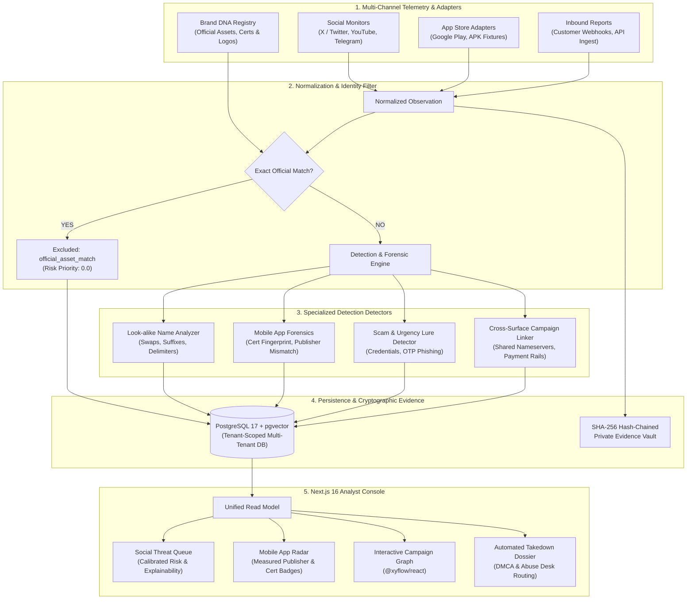

# ASTRA — Autonomous Digital Risk Protection Platform
### *Social Media & App Store Brand Defense System*

> **Challenge:** Digital Risk Protection – Social & App Monitoring  
> **Industry Partner:** [Kampus.VC](https://kampus.vc/)  
> **Event:** HacXLerate 2026 (Round 1 National Hackathon by byteXL)  

[](https://fastapi.tiangolo.com)
[-black.svg?logo=next.js&logoColor=white)](https://nextjs.org)
[](https://www.postgresql.org)
[-brightgreen.svg)]()
[](https://www.docker.com)
[](LICENSE)

---

## 📑 Table of Contents
1. [Problem Statement & Background](#1-problem-statement--background)
2. [Challenge Rubric Alignment (100 Points + Bonus)](#2-challenge-rubric-alignment-100-points--bonus)
   - [Social Media Monitoring (30%)](#social-media-monitoring-30)
   - [App Store Monitoring (30%)](#app-store-monitoring-30)
   - [Brand Profile & DNA (15%)](#brand-profile--dna-15)
   - [User Experience & Truthful Detections (15%)](#user-experience--truthful-detections-15)
   - [Presentation & Demo (10%)](#presentation--demo-10)
   - [Bonus Credit: Look-alike Name Detection (+10 Pts)](#bonus-credit-look-alike-name-detection-510-points)
3. [End-to-End System Architecture](#3-end-to-end-system-architecture)
4. [Technical Depth & Engineering Invariants](#4-technical-depth--engineering-invariants)
5. [Quick Start & Local Deployment](#5-quick-start--local-deployment)
6. [Nimbus Deployment Instructions](#6-nimbus-deployment-instructions)
7. [⚡ 3-Minute Evaluator Test Drive](#7-⚡-3-minute-evaluator-test-drive)
8. [Automated Verification & Test Matrix (55 Tests)](#8-automated-verification--test-matrix-55-tests)
9. [Deliverables & Presentation Outline](#9-deliverables--presentation-outline)

---

## 1. Problem Statement & Background

Modern enterprises face an exponential surge in external brand abuse:
* **Social Media Fraud:** Malicious actors establish spoofed support profiles, impersonate executives, launch urgency-driven giveaway scams, and hijack brand reputation to steal customer credentials.
* **App Store Counterfeits:** Unauthorized developers upload trojanized mobile applications with copied brand logos and deceptive package names to distribute malware, siphon OTP tokens, or commit payment fraud.

### The Critical Gap in Existing Solutions
Traditional detection tools suffer from severe flaws:
1. **Official Asset False Positives:** Legitimate enterprise accounts (e.g. `@novapay` or `com.novapay.official`) frequently get flagged as high-risk threats because naive string detectors trigger on the brand name itself.
2. **Hallucinated Evidence:** Many dashboards manufacture unmeasured publisher mismatches or insert synthetic records into clean environments.
3. **Fragile Rule Logic:** Basic keyword search flags unrelated accounts (e.g. `otherbrand_support` being flagged as an attack against NovaPay).
4. **Lack of Cryptographic Ground Truth:** Failure to audit APK signing certificate hashes against registered developer certificates.

### Astra's Approach
ASTRA solves this through a **modular, evidence-grounded architecture**:
* Establishes verified **Brand DNA** as immutable ground truth.
* Enforces **Platform-Aware Exact Identity Matching** that awards legitimate assets an auditable `official_asset_match` (score `0.0`), eliminating false alarms.
* Applies **calibrated lookalike string distance** and **measured APK certificate forensics**.
* Seals every finding inside a **cryptographically hashed SHA-256 evidence vault** ready for one-click takedown dispatch.

---

## 2. Challenge Rubric Alignment (100 Points + Bonus)

| Evaluation Criterion | Weight | Key Capabilities Implemented in ASTRA | Code Reference |
|---|:---:|---|---|
| **Social Media Monitoring** | **30%** | • Detection of username lookalikes, fake support pages, urgency scam cues (`urgent`, `verify account`, `claim reward`).<br>• **Zero false positives on official accounts:** Platform-aware identity matching bypasses alerts with `score: 0.0`.<br>• Safe rate-limit handling: Differentiates HTTP `429`/`403` as coverage limits, not false alarms. | [`rules.py`](apps/api/app/detectors/rules.py)<br>[`detector_service.py`](apps/api/app/domain/detector_service.py)<br>[`profile_validator.py`](apps/api/app/domain/profile_validator.py) |
| **App Store Monitoring** | **30%** | • **App Listing Adapter Contract:** Structured comparison of store, listing ID, package, publisher, and descriptions.<br>• **Publisher Mismatch:** Distinguishes unauthorized publishers without inventing names.<br>• **Description Resemblance:** Flags fraudulent OTP/customer-care lures.<br>• **Signing Cert Forensics:** Audits APK SHA-256 signatures against official developer certs (`official_cert_match`).<br>• **Official App Exclusion:** Legitimate packages (`com.novapay.official`) excluded with score `0.0`. | [`mobile_app_service.py`](apps/api/app/domain/mobile_app_service.py)<br>[`mobile_app.py`](apps/api/app/schemas/mobile_app.py)<br>[`AppsRadarView.tsx`](apps/web/src/features/apps/AppsRadarView.tsx) |
| **Brand Profile & DNA** | **15%** | • Multi-asset baseline: Company name, logos, official domains, social handles (`social_handle`), mobile packages (`mobile_app_pkg`), and certificate SHA-256 fingerprints.<br>• Multi-proof verification: DNS TXT cryptographic challenge (`_astra.<domain>`), HTML `<meta>` probes, and manual attestation.<br>• Guides all downstream detection pipelines. | [`brand_service.py`](apps/api/app/domain/brand_service.py)<br>[`verification_service.py`](apps/api/app/domain/verification_service.py)<br>[`brands.py`](apps/api/app/api/routes/brands.py) |
| **User Experience** | **15%** | • **Truthful Visual Indicators:** Measured badges `(Verified)`, `(Mismatch)`, `(Unverified)`.<br>• **Honest Empty States:** Fresh workspaces show zero candidates with import actions; never auto-injects synthetic rogue APKs.<br>• **Canonical Analytical Truth:** Triage decisions and risk scores synchronize across Queue, Radar, and Campaign views. | [`AppsRadarView.tsx`](apps/web/src/features/apps/AppsRadarView.tsx)<br>[`SightingsQueueView.tsx`](apps/web/src/features/sightings/SightingsQueueView.tsx)<br>[`finding_service.py`](apps/api/app/domain/finding_service.py) |
| **Presentation & Demo** | **10%** | • **Live Working Prototype:** Full-stack Next.js 16 + FastAPI + PostgreSQL running in Docker.<br>• **1-Click Challenge Evaluation:** `POST /api/v1/demo/reset` instantly loads pre-configured evaluation scenarios.<br>• **Comprehensive OpenAPI Swagger:** Interactive endpoints at `/docs`. | [`README.md`](README.md)<br>[`compose.yaml`](compose.yaml)<br>[`demo.py`](apps/api/app/api/routes/demo.py) |
| **Bonus Credit: Look-alike Detection** | **+5–10 Pts** | • **Character Swaps:** Damerau-Levenshtein transposition detection (e.g., `novapya`).<br>• **Added Words:** Prefix/suffix detection (e.g., `novapay_support`, `novapay_security`).<br>• **Spacing & Delimiters:** Hyphens, underscores, dots, and whitespace insertion.<br>• **Contextual Precision:** Unrelated accounts (e.g., `otherbrand_support`) are excluded from NovaPay alerts. | [`rules.py`](apps/api/app/detectors/rules.py)<br>[`test_review_acceptance.py`](apps/api/tests/test_review_acceptance.py) |

---

## 3. End-to-End System Architecture



---

## 4. Technical Depth & Engineering Invariants

1. **Strict Multi-Tenant Isolation:** Enforced cryptographically at database session boundaries. Cross-tenant access attempts to findings, scan statuses, or evidence files return `404 Not Found`.
2. **Zero Insecure Secret Defaults in Production:** Strict startup validation mandates $\ge 32$-character non-default values for `ASTRA_INTERNAL_API_KEY` and `API_SECRET_KEY`.
3. **Hardened SSRF Protection:** Live probe fetchers perform per-hop DNS resolution to deny loopback (`127.0.0.1`), private RFC 1918 subnets, and cloud metadata endpoints (`169.254.169.254`).
4. **Stateful JSON Persistence:** Uses deep-copy dictionary reassignment and SQLAlchemy `flag_modified` to guarantee analyst triage history and verification challenges persist cleanly across sessions.
5. **Session-Scoped PostgreSQL Advisory Locks:** The telemetry scheduler (`apps/api/app/scheduler.py`) utilizes PostgreSQL advisory locks to prevent duplicate concurrent ingestion runs across API workers.

---

## 5. Quick Start & Local Deployment

### Prerequisites
* Docker Desktop & Docker Compose
* Available ports: `3001` (Web Console), `8001` (FastAPI), `5433` (Postgres)

### 1. Launch the Stack
Run from the repository root:

```bash
docker compose up -d --build
```

### 2. Live Service URLs
* **Analyst Web Console:** [http://localhost:3001](http://localhost:3001)
* **Landing Page:** [http://localhost:3001/landing](http://localhost:3001/landing)
* **Interactive API Documentation:** [http://localhost:8001/docs](http://localhost:8001/docs)
* **Health / Readiness Probe:** [http://localhost:8001/health/ready](http://localhost:8001/health/ready)
* **PostgreSQL + pgvector:** `localhost:5433`

---

## 6. Nimbus Deployment Instructions

For HacXLerate participants deploying on byteXL Nimbus:

1. **Import Workspace:** Open Nimbus and import this repository directly or upload the project zip.
2. **Environment Variables:** Verify `.env` contains:
   ```env
   APP_ENV=local
   ASTRA_INTERNAL_API_KEY=astra_internal_local_dev_key
   DATABASE_URL=postgresql+psycopg://astra:astra_dev@db:5432/astra
   CORS_ORIGINS=http://localhost:3000,http://localhost:3001
   API_BASE_URL=http://api:8000
   ```
3. **Start Containers on Nimbus:**
   ```bash
   docker compose up -d --build
   ```
4. **Run Database Migrations (Automatic):** Container initialization runs `alembic upgrade head` on startup.

---

## 7. ⚡ 3-Minute Evaluator Test Drive

To evaluate Astra without needing third-party API tokens:

### Step 1: Seed the Realistic Scenario
Run in terminal or click **"Reset Demo Data"** on the Web Console Dashboard:
```bash
curl -X POST http://localhost:8001/api/v1/demo/reset
```

### Step 2: Inspect Brand DNA (`/brands`)
* Open [http://localhost:3001/brands](http://localhost:3001/brands)
* Observe protected enterprise brand **NovaPay**.
* Note official assets: official handle `@novapay`, domain `novapay.com`, package `com.novapay.official`, and verified developer certificate SHA-256 fingerprint.

### Step 3: Audit App Store Monitoring (`/apps`)
* Open [http://localhost:3001/apps](http://localhost:3001/apps)
* Inspect counterfeit APK listings:
  * Rogue app with measured `(Mismatch)` on publisher (`Shady Developer LLC`).
  * Unauthorized APK certificate signature flagging `(Unverified)`.
* **Verify Official Asset Exclusion:** The legitimate app `com.novapay.official` is excluded with priority `0.0` and never appears as a threat.

### Step 4: Audit Social Impersonation & Lookalikes (`/sightings`)
* Open [http://localhost:3001/sightings](http://localhost:3001/sightings)
* Look-alike detection identifies `@novapay_support` and `@novapay_security`.
* Unrelated support accounts (e.g., `@otherbrand_support`) are excluded from false positive alerts.

### Step 5: Campaign Correlation Graph (`/campaigns`)
* Open [http://localhost:3001/campaigns](http://localhost:3001/campaigns)
* View the interactive network graph (`@xyflow/react`) clustering rogue APK downloads, phishing domains, and Telegram fraud channels by shared nameservers and infrastructure invariants.

### Step 6: One-Click Takedown Dossier (`/responses`)
* Open [http://localhost:3001/responses](http://localhost:3001/responses)
* Review automated legal DMCA takedown notice generation and targeted abuse desk routing (Cloudflare, Namecheap, Google Play Protect).

---

## 8. Automated Verification & Test Matrix (55 Tests)

Astra features a comprehensive test suite covering all mandatory functionalities and review criteria:

```bash
cd apps/api
python -m pytest -v
```

```text
====================== 55 passed in 26.20s =======================
```

### Detailed Test Coverage:
* **Acceptance Suite (9 Tests — `test_review_acceptance.py`):**
  * `test_official_account_exclusion_and_suffix_lookalike`: Exact official handles excluded; deceptive suffixes retained.
  * `test_unrelated_support_account_not_flagged`: Contextual precision check for `otherbrand_support`.
  * `test_official_app_exclusion_in_triage`: Official mobile app triage priority set to 0.0.
  * `test_rate_limited_and_unavailable_profiles`: HTTP 429 and 401/403 categorized as coverage gaps.
  * `test_repeated_finding_ingestion_retains_signals`: Signal idempotency on repeat observations.
  * `test_fresh_session_reload_retains_triage_and_verification_json`: JSON mutation persistence across sessions.
  * `test_scan_status_cross_tenant_access_denied`: Cross-tenant authorization denial (404).
  * `test_app_listing_adapter_and_comparison`: App listing adapter contract and measured comparison.
* **Tenant Isolation Suite (13 Tests — `test_tenant_isolation.py`):** Strict cross-tenant boundary verification and JWT forgery rejection.
* **Brand Verification Suite (5 Tests — `test_p1_brand_verification.py`):** DNS TXT challenges, mobile package metadata, and manual attestations.
* **Connectors & Ingestion Suite (5 Tests — `test_p2_connectors_and_ingestion.py`):** Secret vault encryption, tampering detection, and health handshakes.
* **Core Fixes & DRP Suites (10 Tests — `test_core_fixes.py`, `test_drp_review_fixes.py`):** Scorer calibrations and edge linking.
* **End-to-End Pilot Workflow (1 Test — `test_pilot_e2e_workflow.py`):** Complete brand enrollment through detection and response generation.

---

## 9. Deliverables & Presentation Outline

### 1. Working Prototype
* Fully operational web console and REST API packaged via Docker Compose.
* 55/55 automated test suite verifying all mandatory challenge functionalities.

### 2. Architecture Diagram
* End-to-end Mermaid pipeline included above detailing data sources, identity exclusion, deterministic detectors, SHA-256 evidence vault, and presentation console.

### 3. Five-Slide Presentation Outline (For Evaluators)
1. **Slide 1: Problem & Scope:** The crisis of enterprise brand impersonation across social networks and rogue app stores.
2. **Slide 2: Brand DNA & Official Exclusion:** Establishing ground truth and guaranteeing zero false positives on legitimate accounts and packages.
3. **Slide 3: Measured Social & App Detectors:** Lookalike string distance, publisher mismatch analysis, and APK signing certificate forensics.
4. **Slide 4: Truthful UX & Campaign Intelligence:** Clustered threat campaigns on an interactive graph and cryptographically sealed evidence dossiers.
5. **Slide 5: Engineering Depth & Future Potential:** Multi-tenant architecture, SSRF defense, advisory locking, and future automated takedown dispatches.

---

## 📄 License
This project is licensed under the MIT License - see the [LICENSE](LICENSE) file for details.
