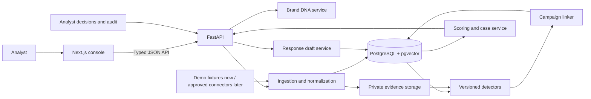

# ASTRA

### Digital Risk Protection, connected by evidence.

ASTRA is an AI-assisted Social & App Monitoring platform that helps brands detect fake profiles, impersonation, scam accounts, lookalike websites, and suspicious mobile apps. It connects related sightings into one explainable campaign so an analyst can understand the threat, prioritize exposure, and prepare a response from one workspace.

> **Hackathon promise:** Turn scattered social, web, and app sightings into one evidence-backed campaign and an analyst-ready response packet.

## The problem

A fake support profile, a lookalike page, a repackaged app, and a reused payment identifier are often investigated as separate alerts. Investigators must establish which brand identities are genuine, find links across platforms, collect evidence, decide urgency, and prepare reports. Disconnected alerts slow response and make repeat campaigns harder to spot.

## What ASTRA does

1. **Establishes trusted identity:** Brand DNA stores a brand's verified domains, handles, app/package identifiers, signing-certificate fingerprints, logos, support channels, and payment identifiers.
2. **Collects sightings:** A normalized evidence model represents social profiles, web pages, app metadata, messages, and customer reports from permitted sources.
3. **Explains detections:** Versioned detectors compare sightings with Brand DNA and return evidence-linked signals, thresholds, and plain-language reasons.
4. **Connects campaigns:** Shared phone numbers, UPI IDs, domains, app identifiers, image fingerprints, and other pivots connect related sightings into a campaign graph.
5. **Prioritizes analyst work:** A transparent risk score combines identity similarity, harm, exposure, and freshness. It is a prioritization heuristic, not a claim of predictive certainty.
6. **Prepares response:** ASTRA generates editable, evidence-backed response drafts and records analyst decisions and response outcomes.

## Product principles

- **Campaigns over isolated alerts:** the analyst investigates the connected operation, not only the latest account.
- **Evidence before AI:** every signal and graph edge points to supporting evidence and records its method/version.
- **Human-controlled response:** models can assist with classification and summaries; analysts approve decisions and external actions.
- **Privacy and permission:** use brand-authorized data and permitted sources; protect tenant data and evidence files.
- **Honest measurements:** prototype metrics use labeled synthetic data and are clearly identified as such.

## Hackathon MVP

The demo uses a fictional brand and deterministic seed data. It shows a suspicious support profile, lookalike web page, app metadata, and a reused phone/UPI pivot connecting them into one prioritized campaign. A benign near-match stays outside the campaign to demonstrate false-positive control.

The MVP includes:

- Brand DNA enrollment
- Seed/reset flow and normalized sightings
- Explainable profile, web, and app metadata checks
- Evidence-backed campaign graph and risk breakdown
- Analyst accept/reject and edge review
- Response packet with evidence references, hashes, and timestamps
- Simulated action and recurrence/time-to-response metrics

Live scraping, real takedowns, automated messaging, and real customer data are outside the hackathon demo scope.

## Architecture

The hackathon build is a modular monolith: one web app, one API, and one Postgres database. Analysis is synchronous for deterministic fixtures. Add worker queues and source connectors after the core workflow is stable and authorized.

## Technology blueprint

| Layer | Planned stack |
| --- | --- |
| Frontend | Next.js 16.4, React 19.3, TypeScript, Node.js 24 LTS |
| UI | Tailwind CSS 4.3, shadcn/ui, Lucide |
| Data and forms | TanStack Query, React Hook Form, Zod |
| Campaign graph and charts | React Flow (`@xyflow/react`), Recharts |
| API | Python 3.14.8, FastAPI, Pydantic v2, Uvicorn |
| Data access | SQLAlchemy 2, Alembic, psycopg 3 |
| Database/search | PostgreSQL 18, pgvector, Postgres full-text search |
| Local environment | Docker Compose; MinIO or local volume for demo evidence |
| API contracts | FastAPI OpenAPI schema generates the TypeScript client |

Use exact locked versions and verify native-library compatibility before adding optional ML packages. Python 3.13 is the fallback if a required image-processing library does not yet support Python 3.14. See the official release pages for [Next.js](https://nextjs.org/blog), [React](https://react.dev/versions), [Node.js](https://nodejs.org/en/about/previous-releases), [Python](https://www.python.org/doc/versions/), and [PostgreSQL](https://www.postgresql.org/docs/release/18.0/).

## Six-phase engineering roadmap

| Phase | Engineering outcome |
| --- | --- |
| 1. Platform foundation | Next.js shell, FastAPI service, Postgres schema/migrations, OpenAPI-generated client, Compose startup, health checks. |
| 2. Brand DNA and evidence | Brand enrollment, seed/reset, evidence hashing/provenance, identifier normalization, tenant-scoped storage. |
| 3. Detection signals | Versioned rule-based detectors, evidence explanations, analysis runs, detector-failure handling. |
| 4. Campaign graph and triage | Indicator linking, confidence-labeled edges, conservative grouping, score contributions, graph UI. |
| 5. Analyst and response workflow | Case decisions, audit timeline, editable response packet, evidence manifest, simulated actions. |
| 6. Product polish and release | Security/access checks, demo metrics, clean setup, error/loading states, deployment, rehearsal and backup. |

## Repository status

This repository is currently a **documentation-first project starting point**. It does not yet contain application source code, dependencies, or executable setup scripts. The roadmap describes the intended implementation; phase 1 will establish the runnable project and publish verified setup commands. No demo or production deployment is available from this initial README alone.

## Planned development setup

When phase 1 lands, the repository will include a one-command Docker Compose startup, an environment template, database migrations, a deterministic demo seed, and a reset command. Until those files are present, there is no valid application run command to provide.

## Security and response boundaries

- Every customer-owned record will be scoped to a tenant; authorization is enforced by the API.
- Evidence files remain private and are stored with hashes and provenance.
- The demo does not fetch arbitrary URLs, execute APKs, or contact suspected accounts.
- Imported content is treated as untrusted input.
- AI output is advisory and schema-validated; it cannot approve a case or initiate external actions.
- Takedowns, payment-provider reports, and customer warnings require authorized integrations and explicit human approval.

## Success measures

For the labeled synthetic demo set, report:

- Detection precision/recall by surface, with sample counts
- Campaign-linking correctness against known campaign membership
- Time from fixture ingestion to ranked campaign
- Share of detections with visible evidence-backed explanations
- False-positive change with Brand DNA checks enabled
- Recurrence linking when a later sighting reuses an existing indicator

Do not present synthetic demo results as real-world accuracy or takedown performance.

## Contributing

The first implementation should keep API contracts, fixture schema, and data model in sync. Add a source connector only when its data access is permitted and it can emit the normalized Sighting format. Check dependency and asset licenses before including them. The detailed engineering plan will be maintained alongside the code as the architecture evolves.

## License

No license has been declared for this repository yet. Until a LICENSE file is added, reuse and redistribution permissions are not specified.
