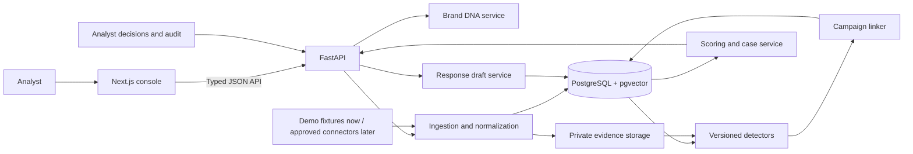

# ASTRA

### Digital Risk Protection, connected by evidence.

ASTRA is an early-stage Digital Risk Protection platform for reviewing suspected fake profiles, impersonation, scam accounts, lookalike websites, and suspicious mobile apps. It provides a web console, FastAPI service, tenant-scoped records, deterministic analysis, campaign linking, and response-draft workflows.

> **Enterprise Architecture:** ASTRA is an advanced Digital Risk Protection (DRP) and Brand Defense platform. It combines automated multi-channel telemetry ingestion, Brand DNA verification, campaign graph clustering, deterministic & AI-assisted threat scoring, automated takedown response workflows, and continuous background monitoring.

For the detailed architectural specification and engineering overview, see [docs/architecture.md](docs/architecture.md) and [docs/phase-status.md](docs/phase-status.md).

## Current project status

Implemented code and planned enterprise capabilities are tracked separately in [docs/phase-status.md](docs/phase-status.md). A roadmap describes the intended destination; it does not certify production readiness.

## Start locally

### Requirements

- Docker Desktop with Docker Compose
- Ports 3000, 8000, and 5433 available

### Run the stack

From the repository root:

```bash
docker compose up --build
```

Open:

- Web console: http://localhost:3000
- API documentation: http://localhost:8000/docs
- API liveness: http://localhost:8000/health/live
- API readiness: http://localhost:8000/health/ready
- PostgreSQL: localhost:5433 (local development only)

The first start builds the containers, waits for PostgreSQL, applies Alembic migrations, and starts the web console and API. Local demo access is enabled only by the Compose development configuration. Do not expose this setup to the public internet.

Stop the stack with Ctrl+C. Local development credentials in `compose.yaml` are for a local-only environment and must not be reused for a public deployment.

## ⚡ Quick Evaluator Walkthrough (2-Minute Test Drive)

For rapid evaluation without configuring external API keys (VirusTotal, Telegram bot, etc.), ASTRA comes pre-configured with a comprehensive realistic multi-channel threat scenario:

1. **Seed Demo Scenario**: In the web console, click **"Reset Demo Data"** on the Dashboard or execute:
   ```bash
   curl -X POST http://localhost:8000/api/v1/demo/reset
   ```
2. **Explore Brand DNA & Verification (`/brands`)**:
   - Inspect enrolled enterprise brands (e.g., `ACME Corporation`).
   - Open the **Verification Modal** to test the multi-proof validation engine (DNS TXT challenge `_astra.<domain>`, HTML `<meta>` tag, and `.well-known` HTTP token probes).
3. **Interactive Campaign Graph (`/campaigns`)**:
   - Open a campaign to view the interactive network graph (`@xyflow/react`).
   - Observe how isolated phishing domains, rogue Android APKs, and Telegram channels are clustered together based on shared nameservers, registrar IDs, and payment handles.
4. **Mobile App Radar (`/apps`)**:
   - Audit rogue mobile packages targeting the brand. Review official vs. fraudulent developer signing certificate SHA-256 fingerprints.
5. **One-Click Takedown & Evidence Dossier (`/responses`)**:
   - View automated legal DMCA takedown notice generation and targeted abuse desk contact routing (Cloudflare, AWS Abuse, Namecheap, Google Play Protect).
   - Export forensic evidence packets backed by cryptographic SHA-256 hash chains.
6. **Continuous Monitoring & Connectors (`/connectors`)**:
   - Review live connectors (Composio, VirusTotal, crt.sh Certificate Transparency, Telegram, YouTube).
   - Background telemetry poller (`apps/api/app/scheduler.py`) continuously queries active sources with PostgreSQL session-scoped advisory locks.

## What ASTRA is designed to do

1. **Establish trusted identity:** Brand DNA records official domains, handles, apps/package IDs, signing-certificate fingerprints, logos, support channels, and payment identifiers.
2. **Ingest sightings:** A normalized evidence model represents social profiles, web pages, app metadata, messages, and customer reports from permitted sources.
3. **Explain detections:** Versioned detectors compare sightings with Brand DNA and return evidence-linked signals, thresholds, and clear reasons.
4. **Connect campaigns:** Shared phone numbers, UPI IDs, domains, app identifiers, image fingerprints, and other pivots connect related sightings.
5. **Prioritize investigation:** A transparent heuristic combines identity similarity, harm, exposure, and freshness. It is not presented as a probability.
6. **Prepare response:** ASTRA creates editable response drafts and records analyst decisions and response outcomes.

## Architecture



The hackathon build is a modular monolith: one web app, one API, one Postgres database. The first scaffold uses synchronous requests; add workers only when ingestion or analysis has long-running jobs. The browser never accesses the database or evidence bucket directly.

## Technology stack

| Layer | Planned technology |
| --- | --- |
| Frontend | Next.js 16.4, React 19.3, TypeScript, Node.js 24 LTS |
| UI | Tailwind CSS 4.3; shadcn/ui components as features are built |
| Client data/forms | TanStack Query, React Hook Form, Zod |
| Campaign graph/charts | React Flow (`@xyflow/react`), Recharts |
| API | Python 3.14, FastAPI, Pydantic v2, Uvicorn |
| Database access | SQLAlchemy 2, Alembic, psycopg 3 |
| Database/search | PostgreSQL 18, pgvector, Postgres full-text search |
| Local services | Docker Compose; private evidence volume/MinIO in later phase |
| API contract | FastAPI OpenAPI will generate the TypeScript client |

## Repository layout

```text
apps/
  web/                 Next.js app and analyst experience
  api/                 FastAPI app, domain modules and migrations
infra/
  postgres/            Database extension initialization
  compose.yaml         Local stack definition
packages/
  api-client/          Planned generated TypeScript bindings
  fixture-contract/    Planned shared demo fixture schema
docs/
  architecture.md
  phase-status.md
```

Backend folders are organized for `domain`, `ingestion`, `detectors`, `linking`, `scoring`, `evidence`, `ai`, and `seed`. These modules are intentionally scaffolds for the next phases.

## Six-phase implementation plan

| Phase | Outcome |
| --- | --- |
| 1. Platform foundation | Web/API/database scaffold, migrations, health and overview. **Foundation files are present.** |
| 2. Brand DNA and evidence | Enrollment, deterministic seed/reset, private evidence hashing, normalized indicators. |
| 3. Detection signals | Versioned rule-based checks with evidence-backed explanations. |
| 4. Campaign graph and triage | Conservative cross-surface linking, confidence-labeled edges, transparent score. |
| 5. Analyst and response workflow | Decisions, audit timeline, editable response packet, simulated action. |
| 6. Release readiness | Tenant/access hardening, polished states, deployment, demo runbook and rehearsal. |

Track progress in [docs/phase-status.md](docs/phase-status.md). See [docs/architecture.md](docs/architecture.md) for system boundaries.

## Safety and trust boundaries

- Every customer-owned record will be tenant-scoped and authorized by the API.
- Evidence files remain private and carry hashes and provenance.
- The hackathon demo will use synthetic data; it will not fetch arbitrary URLs, execute APKs, or contact suspected accounts.
- AI output is advisory and schema-validated. It cannot approve cases or initiate external actions.
- Takedowns, payment-provider reports, and customer warnings require permitted integrations and explicit human approval.
- Prototype measurements will be labeled as synthetic and will not be presented as real-world accuracy or takedown performance.

## Contributing

Keep API contracts, fixture schema, and database models aligned. Generate the frontend client from the FastAPI OpenAPI schema rather than hand-maintaining duplicate types. Add a source connector only when data access is permitted and it can emit the shared normalized Sighting format. Review third-party code, model, and asset licenses before shipping.

## License

This project is licensed under the MIT License - see the [LICENSE](LICENSE) file for details.
# Astra
