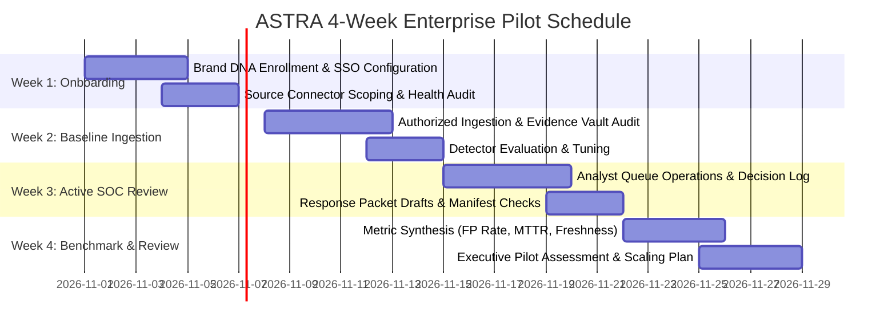

# ASTRA Controlled Enterprise Customer Pilot Runbook

## 1. Pilot Executive Charter & Scope

ASTRA's enterprise pilot is designed to prove real-world value with **truthful metrics, zero ungrounded marketing claims, and strict data safeguards**.

| Parameter | Pilot Configuration |
| :--- | :--- |
| **Design Partner** | NilaPay Financial Services (Fintech) |
| **Monitored Brand** | `NilaPay` (Brand DNA enrolled with official domains, verified handles, UPI IDs) |
| **Authorized Ingestion** | 1 Authorized Channel (Customer SOC Report Intake & Meta Webhook) |
| **Analyst Group** | 3 Security Analysts + 1 Reviewing Org Admin |
| **Duration** | 4 Weeks (Phased rollout) |
| **Mode** | Evidence-backed detection, draft responses, and simulated submissions (no automated external actions without review) |

---

## 2. Customer Data Ownership, Security & Privacy Agreement

1. **Data Ownership:**
   * Customer retains 100% exclusive ownership of all Brand DNA assets, ingested sightings, captured evidence bytes, and analyst decision logs.
   * ASTRA does not use customer evidence to train shared models without written consent.
2. **Tenant Isolation:**
   * Enforced at the application gateway and database layer. Customer findings are cryptographically scoped to `tenant_id`. Cross-tenant access is structurally impossible (verified by automated tests).
3. **Data Retention & Erasure:**
   * Standard retention: 90 days for captured evidence.
   * On-demand deletion: Org Admin can request permanent deletion or execute customer offboarding via `purge_tenant_evidence` (GDPR / DPDP compliant).
4. **Support & Incident Escalation:**
   * **P1 (Connector / Data Ingestion Failure):** Response SLA < 30 minutes.
   * **P2 (API Availability / Performance Issue):** Response SLA < 2 hours.
   * **Direct Incident Contact:** `soc-support@astra.security` | 24/7 Hotline.

---

## 3. Measurable Pilot Evaluation Metrics (Rubric)

Pilot success is judged on measured engineering benchmarks, not marketing claims:

| Metric | Measurement Method | Enterprise Pilot Benchmark |
| :--- | :--- | :--- |
| **Finding Actionability Rate** | Ratio of findings marked `Confirmed` or `Investigate` vs `Ignored` | ≥ 80% actionable |
| **Mean Time to Review (MTTR)** | Timestamp from ingestion to analyst decision submission | ≤ 10 minutes |
| **Evidence Completeness** | Percentage of sightings with valid SHA-256 hash and verifiable raw bytes | 100% (Zero tolerance for missing evidence) |
| **Measured False Positive Rate** | Ratio of findings marked `Benign / False Positive` by analyst | ≤ 5% across versioned detectors |
| **Connector Freshness Lag** | Delay between external platform event and ASTRA queue delivery | ≤ 15 minutes |
| **Manual Workflow Friction** | Count of manual steps required before generating a finalized response draft | ≤ 2 clicks (Review -> Confirm -> Export Draft) |

---

## 4. Four-Week Phased Execution Cadence

### Week 1: Tenant Setup & Brand DNA Enrolment
* Provision isolated tenant for NilaPay.
* Enrol official Brand DNA:
  * Official Domain: `nilapay.com`
  * Official Social Handle: `@nilapay_official`
  * Official Support UPI: `support@nilapay`
  * Official Mobile App Package: `com.nilapay.app` (signing cert SHA-256)
* Verify connector health via `GET /api/v1/integrations/status`.

### Week 2: Ingestion & Evidence Chain Verification
* Connect single authorized intake queue.
* Ingest first batch of candidate impersonations.
* Audit evidence storage vault: verify SHA-256 integrity and signed token generation.

### Week 3: SOC Analyst Investigation & Decisioning
* Analysts use ASTRA console (`/sightings`, `/campaigns`) to review findings.
* Versioned deterministic detectors highlight homoglyphs, urgency lures, and suspicious UPI handles.
* Reviewers approve response drafts (Platform Takedown, Payment Block Advisory).

### Week 4: Metrics Evaluation & Pilot Exit Report
* Calculate real measured KPIs against the evaluation rubric.
* Review feedback on workflow friction and detector thresholds.
* Plan multi-brand and multi-source expansion based on verified evidence.
