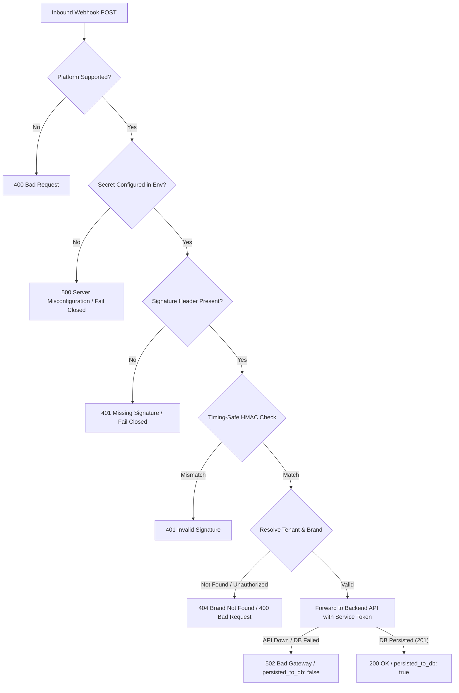

# Implementation Plan: Meta Webhook Hardening & Ingestion Resilience

## Executive Summary & Vulnerability Analysis

Review finding **P0 #2** highlights a critical architectural defect in the public social webhook intake route ([`apps/web/src/app/api/webhooks/[platform]/route.ts`](file:///c:/Users/Lenovo/Astra/apps/web/src/app/api/webhooks/%5Bplatform%5D/route.ts)):

1. **Fail-Open Signature Verification**:
   - Lines 73–84 verify the `X-Hub-Signature-256` header **only** if both `signatureHeader` and `process.env.META_APP_SECRET` are truthy (`if (signatureHeader && appSecret)`).
   - If an attacker omits the header, or if the environment variable is not configured, signature verification is silently bypassed. Unverified third-party HTTP POST payloads are forwarded straight into threat analysis and database ingestion.
2. **Hardcoded Fallback Handshake Secret**:
   - Line 20 uses `process.env.META_VERIFY_TOKEN || 'astra_meta_verify_secret'`.
   - Any external caller knowing the default string can execute the Meta webhook subscription handshake against unconfigured development or staging environments.
   - Twitter/X CRC handshake falls back to `sha256_mock_${crcToken}` when `X_CONSUMER_SECRET` is missing.
3. **Missing Tenant & Brand Context Binding**:
   - The webhook processor statically references `DEFAULT_BRAND_REGISTRY` (an in-memory mock brand).
   - In a multi-tenant enterprise system, unauthenticated webhooks cannot determine which tenant owns the target asset, leading to cross-tenant pollution or unassociated orphan records.
4. **Dishonest HTTP 200 Confirmation**:
   - When forwarding to FastAPI backend (`/api/v1/sightings:batch`), the request lacks authentication headers and `brand_id`, causing backend persistence to fail (`dbIngestionSuccess = false`).
   - The route nonetheless returns `HTTP 200 OK` with `{ success: true, message: "Payload ingested, verified, and processed..." }`, giving callers false assurance that evidence has been durably preserved.

---

## Architectural Objectives & Success Criteria



| Dimension | Target Specification |
| :--- | :--- |
| **Security Posture** | **Strictly Fail-Closed**: Zero incoming payloads processed without valid cryptographic signatures. |
| **Secret Hygiene** | **No Insecure Fallbacks**: Production and development reject requests if secrets are undefined. |
| **Multi-Tenancy** | **Explicit Tenant/Brand Scoping**: Webhooks must bind to a verified `tenant_id` and `brand_id`. |
| **Integrity Contract** | **Truthful Status Codes**: HTTP 200/201 only if written to PostgreSQL; HTTP 502 if backend persistence fails. |
| **Timing Attacks** | `crypto.timingSafeEqual` prevents side-channel character enumeration. |

---

## Detailed Step-by-Step Implementation

### Step 1: Fail-Closed GET Verification Handshake

File: [`apps/web/src/app/api/webhooks/[platform]/route.ts`](file:///c:/Users/Lenovo/Astra/apps/web/src/app/api/webhooks/%5Bplatform%5D/route.ts)

1. **Meta / Instagram (`hub.mode === 'subscribe'`)**:
   - Retrieve `process.env.META_VERIFY_TOKEN`.
   - If not set or empty: Return `500 Internal Server Error` (`"Server misconfiguration: META_VERIFY_TOKEN is not configured"`).
   - If `hubVerifyToken !== expectedToken`: Return `403 Forbidden` (`"Invalid webhook verification token"`).
   - Only return `hubChallenge` with HTTP 200 when strictly matched.
2. **Twitter / X CRC Handshake**:
   - Retrieve `process.env.X_CONSUMER_SECRET`.
   - If not set: Return `500 Internal Server Error` (`"Server misconfiguration: X_CONSUMER_SECRET is not configured"`).
   - Remove `sha256_mock_${crcToken}` fallback completely.

---

### Step 2: Fail-Closed POST Signature Enforcement

File: [`apps/web/src/app/api/webhooks/[platform]/route.ts`](file:///c:/Users/Lenovo/Astra/apps/web/src/app/api/webhooks/%5Bplatform%5D/route.ts)

1. **Meta / Instagram / Facebook**:
   - Extract `x-hub-signature-256` header.
   - If `!process.env.META_APP_SECRET`:
     - Log security warning.
     - Return `500 Internal Server Error` (`{ error: "Server misconfiguration: META_APP_SECRET is not configured" }`).
   - If `!signatureHeader || !signatureHeader.startsWith('sha256=')`:
     - Return `401 Unauthorized` (`{ error: "Missing or malformed X-Hub-Signature-256 header" }`).
   - Compute HMAC:
     ```typescript
     const expectedHash = crypto
       .createHmac('sha256', process.env.META_APP_SECRET)
       .update(rawText)
       .digest('hex');
     const providedHash = signatureHeader.slice(7); // remove "sha256="
     ```
   - Validate length and perform constant-time check:
     ```typescript
     if (providedHash.length !== expectedHash.length ||
         !crypto.timingSafeEqual(Buffer.from(providedHash, 'hex'), Buffer.from(expectedHash, 'hex'))) {
       return NextResponse.json({ error: "Invalid webhook signature" }, { status: 401 });
     }
     ```
2. **Telegram (`platform === 'telegram'`)**:
   - Verify `x-telegram-bot-api-secret-token` header against `process.env.TELEGRAM_WEBHOOK_SECRET`.
   - If secret token is missing or mismatched, return `401 Unauthorized`.

---

### Step 3: Tenant & Brand Binding Strategy

Webhooks must bind incoming events to an enterprise tenant and brand rather than the dummy `DEFAULT_BRAND_REGISTRY`.

#### Ingestion Routing Options

1. **Explicit Route Parameters**:
   - Webhook URL format: `/api/webhooks/[platform]?tenant_id=<UUID>&brand_id=<UUID>` or via dedicated header `X-Astra-Brand-Id`.
   - The route validates `tenant_id` and `brand_id` formats as valid UUIDs.
2. **Account Identifier Resolution (Fallback)**:
   - If query parameters are omitted, inspect the payload for account identifiers (e.g., Instagram Business Account ID `entry[0].id` or `username`).
   - Query backend `/api/v1/brands` or resolution endpoint to match against enrolled `BrandAsset` records (`asset_type: 'handle' | 'social_id'`).
   - If resolution fails, reject with `422 Unprocessable Entity` (`"Unrecognized brand target: No tenant enrolled for this external identifier"`).

#### Authenticated Forwarding to Backend API

- When calling `${apiBaseUrl}/api/v1/sightings:batch`:
  - Provide server authentication header:
    - Use `process.env.ASTRA_INTERNAL_API_KEY` (configured to match backend `admin_api_key` or `api_secret_key`).
    - Format: `Authorization: Bearer ${serviceKey}` or `X-API-Key: ${serviceKey}`.
  - Structure request body to match `SightingBatchRequest`:
    ```json
    {
      "brand_id": "<target_brand_uuid>",
      "sightings": [
        {
          "surface": "instagram",
          "source_kind": "direct_message",
          "observed_at": "2026-10-11T10:40:00Z",
          "raw_ref": "instagram://nilapay_fraud_desk/live-12345",
          "content": "...",
          "sender": { ... },
          "normalized_payload": { ... }
        }
      ]
    }
    ```

---

### Step 4: Truthful Status Codes & Response Payloads

Replace misleading `HTTP 200` with status codes reflecting persistence reality:

```typescript
if (!dbIngestionSuccess) {
  return NextResponse.json(
    {
      success: false,
      error: "Ingestion pipeline failure: Sighting could not be persisted to system of record",
      persisted_to_db: false,
      threat_analyzed: true,
      diagnostic_status: backendResponseStatus
    },
    { status: 502 } // Bad Gateway (downstream backend error)
  );
}

return NextResponse.json(
  {
    success: true,
    message: "Webhook event cryptographically verified and persisted to tenant system of record",
    persisted_to_db: true,
    tenant_id: targetTenantId,
    brand_id: targetBrandId,
    threatSeverity: threatAnalysis.severity,
    riskScore: threatAnalysis.riskScore,
    processedMessage: socialMessage
  },
  { status: 200 }
);
```

---

### Step 5: Verification & Automated Test Matrix

We will add automated tests covering all fail-closed branches and persistence states:

| Test Case | Scenario | Expected Status |
| :--- | :--- | :--- |
| `TC-WH-01` | GET Meta handshake with missing server `META_VERIFY_TOKEN` | `500 Internal Server Error` |
| `TC-WH-02` | GET Meta handshake with incorrect verify token | `403 Forbidden` |
| `TC-WH-03` | GET Meta handshake with exact valid verify token | `200 OK` (returns hub.challenge) |
| `TC-WH-04` | POST Meta event without `X-Hub-Signature-256` header | `401 Unauthorized` |
| `TC-WH-05` | POST Meta event with tampered body or invalid signature | `401 Unauthorized` |
| `TC-WH-06` | POST Meta event when `META_APP_SECRET` is unset | `500 Internal Server Error` |
| `TC-WH-07` | POST Meta event with valid signature but missing/invalid tenant/brand | `422 Unprocessable Entity` |
| `TC-WH-08` | POST Meta event with valid signature, but backend API unreachable | `502 Bad Gateway` (`persisted_to_db: false`) |
| `TC-WH-09` | POST Meta event with valid signature, authenticated backend write | `200 OK` (`persisted_to_db: true`) |

---

## File Change Matrix

| File Path | Description of Edits |
| :--- | :--- |
| [`apps/web/src/app/api/webhooks/[platform]/route.ts`](file:///c:/Users/Lenovo/Astra/apps/web/src/app/api/webhooks/%5Bplatform%5D/route.ts) | Implement fail-closed signature verification, remove default fallback secrets, bind tenant/brand, send service auth headers, and return honest HTTP status codes. |
| [`.env.example`](file:///c:/Users/Lenovo/Astra/.env.example) | Remove hardcoded `META_VERIFY_TOKEN=astra_meta_verify_secret` default and add documentation for webhook secrets. |
| [`apps/api/app/integrations/meta.py`](file:///c:/Users/Lenovo/Astra/apps/api/app/integrations/meta.py) | Verify signature helper consistency with timing-safe comparison. |
| [`apps/api/tests/test_evidence_and_connectors.py`](file:///c:/Users/Lenovo/Astra/apps/api/tests/test_evidence_and_connectors.py) | Add integration tests for webhook verification rejection. |
| [`docs/phase-status.md`](file:///c:/Users/Lenovo/Astra/docs/phase-status.md) | Update verification log with P0-2 resolution. |
